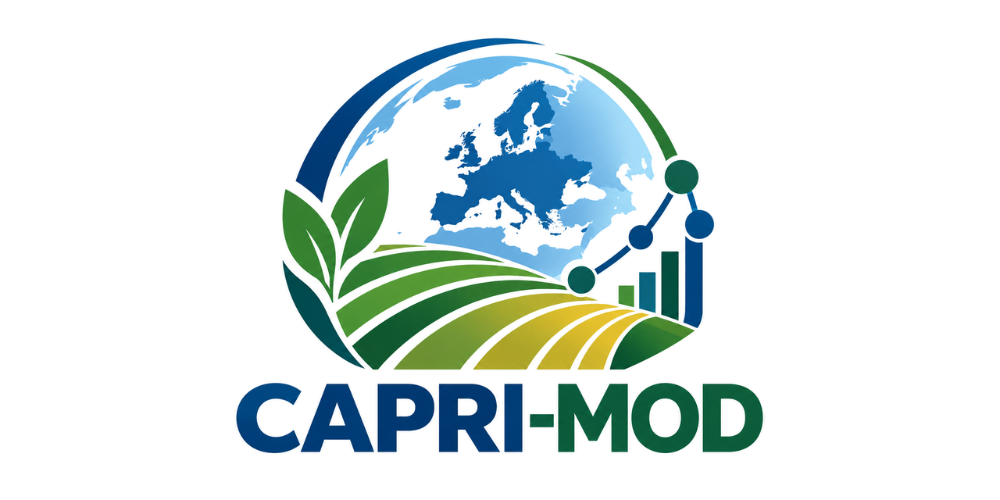

[](https://github.com/nuvolaTeam/CAPRI-MOD/actions/workflows/docker-publish.yml)
[](https://github.com/nuvolaTeam/CAPRI-MOD/actions/workflows/python-app.yml)
<p align="center">
  <picture>
    <source media="(prefers-color-scheme: dark)" srcset="docs/assets/capri-mod-logo-white.png">
    
  </picture>
</p>

# CAPRI-mod

**An AI-assisted, validated Python reimplementation of the economic logic of the
CAPRI model** (Common Agricultural Policy Regionalised Impact).

CAPRI-mod reproduces CAPRI's regional agricultural supply, market, policy,
environmental, feed and biofuel behaviour across **CAPRI's 221 regional units (EU27 +
Norway)**, **49 activities** (37 crops, 12 livestock), **58 market
commodities** and **CAPRI's 45 market regions**. Every input is traceable to a source, and each module's output
has been compared with CAPRI's own data or scenario results; §8 says which
outputs hold up and which do not.

In practice, each equation cites the CAPRI code
it follows and each departure is registered, the code is open Python on CSV inputs
with their provenance and CAPRI's own codes, and every run's settings, result
quality and decisions are recorded in machine-readable form.

The project tests whether a large policy model, CAPRI in this case,
can be reimplemented in a form that is transparent, reusable, reproducible,
interoperable and AI-ready (§9). It is a feasibility test and independent implementation of CAPRI's *methods and calibration data*,
not a copy of its code. §8 and §11 say how far it has got.

---

## Table of contents

1. [Overview](#1-overview)
2. [Why CAPRI-mod](#2-why-capri-mod-strengths)
3. [Installation & quick start](#3-installation--quick-start)
4. [The data layer](#4-the-data-layer)
5. [Model architecture](#5-model-architecture)
6. [Baseline & scenarios](#6-baseline--scenarios)
7. [Running the model](#7-running-the-model)
8. [Validation](#8-validation)
9. [AI readiness, reusability and reproducibility](#9-ai-readiness-reusability-and-reproducibility)
10. [Differences from CAPRI](#10-differences-from-capri)
11. [Known limitations](#11-known-limitations)
12. [Provenance & reproducibility](#12-provenance--reproducibility)
13. [Relationship to CAPRI](#13-relationship-to-capri)

---

## 1. Overview

### What the model does

CAPRI-mod is a **partial-equilibrium model of EU agriculture, comparative
static per simulation year as CAPRI, with an optional multi-year projection
layer**. Given a
policy or price shock, the core computes how the base-year agricultural economy
re-settles into a new equilibrium: how farmers reallocate land and herds, how
markets clear, and what the environmental consequences are. The projection layer
runs that core forward along an externally-adopted baseline trajectory.

Both halves of that description carry caveats worth reading before relying on
either:

- **Nearly all the validation sits on the comparative-static core.** The
  projection has been validated for a **single step** to 2030, against CAPRI's
  own 2030 reference (correlation +0.993, total cropped area within 3%,
  20 of 23 crops within 25%).
- **Multi-period recursion runs and produces year-specific results, but has not
  been validated against an external reference.** Only perennial crop areas are
  carried between periods; herds are re-optimised each period, which overstates
  livestock adjustment speed.
- **The trajectory is exogenous** — adopted from CAPRI's `captrd` baseline, not
  generated by this model. This is deliberate, and CAPRI's own documentation
  supports it: it describes baseline construction as a mix of trend analysis,
  model runs and expert consultation in which *"it is almost unavoidable that the
  process is somewhat intransparent"*. A projection is defended by showing which
  conclusions survive across plausible trajectories, not by claiming one is right.
- **Partial equilibrium is deliberate**: agriculture is resolved, the wider
  economy is not — the same boundary CAPRI draws (see §11).

> **Before using a number from this model, read §8 (Fitness for use).** Several
> reported fields are sound and several are not, and without a CAPRI installation
> you have no independent way to tell which is which.

**It answers:** *"What does this policy, on its own, do to the agricultural
sector?"* — the policy effect, separated from baseline drift and from
economy-wide feedbacks.

"On its own" means two specific things, and one thing it does **not** mean:

- **Separated from baseline drift.** In a projection, `ProjectionModule.run()`
  solves each target year twice — baseline and scenario — and reports the
  increment separately, so a 2030 result never conflates "the world changing
  anyway" with "what the policy did".
- **Separated from economy-wide feedbacks.** Labour markets, capital and GDP
  effects lie outside the partial-equilibrium boundary — **the same boundary
  CAPRI draws**. CAPRI is also partial-equilibrium and reaches economy-wide
  effects by *linking* to an external CGE (GTAP, via its `capri_gtap` and
  `cgemrk` modules), not by embedding one. We share the boundary and the
  principle; we differ in maturity, since CAPRI has that linkage implemented and
  this model does not.
- **NOT insulated from world markets.** The market module carries CAPRI's 45 market
  regions with Armington substitution, so an EU policy moves world prices and
  those feed back into EU supply. Leakage is *modelled*, not excluded — the same
  channel JRC121368 flags when it notes that an EU-only Farm-to-Fork leaks a
  significant share of its emission gains abroad.

Against published CAPRI results (JRC121368), the full-EU Farm-to-Fork 2030 run (14 November 2026, converged in 14
iterations): farmland +3.2% against +3%; production of cereals −16.3% against −15%, oilseeds −12.2% against −15.4%,
vegetables and permanent crops −13.0% against −12%, beef −14.4% against −14.2%; N surplus −32.8% against −33.5%; mean
absolute deviation over 20 indicators 4.74 points. The largest gaps are prices (pork +21% against +43%, milk +22%
against +1%) — see [§8](#8-validation).

### The base year is a parameter, not a fixed assumption

Inputs are organised under `capri_data/<base_year>/` and selected via
`load_all_data(base_year=...)`. The only populated base year is **2017**. The base year is a parameter of the run
(`CAPRIModel(base_year=...)` or the setting `run.base_year`): every reader takes its folder and file names from it,
and a base year without a data folder stops with an error naming the years that have one (KNOWN_ISSUES K52f). The
builders (`tools/build`) still write 2017.
Re-basing to a newer year requires extracting that year's CAPRI data into a new `capri_data/<year>/` folder,
with the base year in the file names as in the 2017 folder.

**2017 is CAPRI's own vintage, not a lag on our side.** The CAPRI star-3.0
installation this model was built from is itself 2017-based: its `capreg`
extracts carry no year dimension, and every result file is `res_17…`,
`pmppar_17…`, `reqrel_17…`, with `_1720`/`_1725`/`_1730` being *simulation* years
projected **from** base 2017. There is no newer base year inside that release.
Matching it is therefore correct for a reimplementation — a newer base would need
a newer CAPRI release with `coco`/`capreg` re-run, not a different extraction.

The market side is less constrained: CAPRI's `p_dataMarket` carries 1984–2021, so
world balances *could* be updated independently. That is deliberately not done. A
2021 market against a 2017 supply base would be internally inconsistent — the
market module's base balances supply and demand to 0.003% precisely because both
sides share a vintage — and 2021 prices are atypical (post-COVID, already
disrupted), which makes them a poor policy baseline regardless.

### Who this is for, and what you need

This is a research tool for anyone working on EU agricultural economics — not only
people with access to CAPRI. Two things follow.

**You do not need a CAPRI installation to run it.** The calibrated base-year data
ships with the repository: CAPRI's 221 regional units, 49 activities, market data for CAPRI's 45
market regions (its two EU blocks and 43 others). `pip install -r requirements.txt` and a two-region baseline runs in a
few minutes; a full EU Farm-to-Fork 2030 run takes about 70 minutes on 2 cores
(§1, At a glance). No GAMS licence and no proprietary solver are needed; the optional joint market solver (G3, §1)
is fastest with Intel MKL's PARDISO (`pypardiso`, free under Intel's licence) and can use HSL's solvers where the user
holds an HSL licence, as CAPRI's users hold CONOPT's.

**Any machine.** No file of the repository names a folder of a particular machine (a test checks it:
`capri_mod/tests/test_portable_paths.py`); every path is relative to the repository. The runs and tests are made on
Linux. On Windows, which has no `fork`, the regional solves run in one process, so a run is slower; Windows and macOS
have not been tested. Rebuilding the data from CAPRI's own exports needs those exports, placed as
docs/EXTERNAL_SOURCES.md describes; running the model does not.

**You do need one to re-derive the validation.** Every comparison in §8 was made
against CAPRI output or published CAPRI-based studies. The *results* of those
comparisons are recorded here, and the reference extracts used are shipped where
licensing allows (`capri_data/validation/`). But independently reproducing them —
extracting a different symbol, checking a different year — requires CAPRI itself,
which is available from the [CAPRI network](https://www.capri-model.org).

**What that means in practice.** If you use this model and get a surprising
result, you cannot cross-check it against CAPRI the way its developers can. So the
limitations in §8 carry more weight for you than they would for a CAPRI user: the
fields flagged there as unverified or contaminated are ones you have no
independent way to catch. Read §8 before trusting a number, and prefer the
quantities with external validation behind them — land allocation, production,
nutrient balances, market prices — over those without.

**Prior knowledge assumed.** Positive Mathematical Programming and Armington
trade are used without derivation; §4 gives the equations and cites the
originals. Familiarity with CAPRI's activity codes helps but is not required:
CAPRI's own documentation (the January 2022 manual) lists them, and the data
files record how they map to this model's names.

### At a glance

| | |
|---|---|
| Regions | CAPRI's 221 regional units (EU27 215, Norway 6), CAPRI's 8-character codes |
| Activities | 49 (37 crops, 12 livestock) |
| Market commodities | 58 |
| Base year | 2017 (parameterised); scenarios usually solved in 2030 |
| Supply method | CAPRI's regional models as NLPs, PMP-calibrated (CAPRI's 2030 terms) |
| Market method | CAPRI's market model (m_globMarket) as ported: 45 market regions (the EU as CAPRI's two blocks), bilateral Armington trade, transport costs, tariffs, bilateral and global TRQs, entry prices and flexible levies; GL food demand, processing and crushing, dairy blocks, biofuels, feed bulks, young animals, non-EU land markets, CAPRI's market supply functions; calibrated once per run at CAPRI's 2030 market data; solved by a fixed point (Newton per commodity, Anderson) to < 1e-7, or optionally as one system (G3) |
| Data validator | 796 data files declared (CSV inputs, Parquet sources), 0 violations (14 November 2026) |
| Test suite | 478 tests, 98 of them slow (full-EU or multi-solve); 14 November 2026: the fast ones 378 passed, 2 skipped; of the slow ones the market's 24 touched by the day's ports passed (the whole slow set runs with the full Farm-to-Fork and Green Deal pair) |
| On by default, as in CAPRI | land market and land rules, endogenous feed rations, fodder equality, ammonia technologies |
| Optional | manure market (`use_manure_market`) |
| Full-EU 2030 runs | Farm-to-Fork about 70 minutes on 2 cores (14 iterations, 4,222 s), Green Deal about 54 minutes (20 iterations, 3,222 s; 14 November 2026), plus about an hour once per new baseline for the market supply Hessian; regions solved in parallel (setting `run.n_workers`), same results |
| Solvers | IPOPT via CasADi (supply), Clarabel (manure pools), the market's fixed point (Newton per commodity) or G3 (Newton with MKL PARDISO, a continuation on the quotas' slope, IPOPT with MUMPS), HiGHS (LP checks) |

### Where things stand (14 November 2026)

**Current state.** The model's regions are CAPRI's 221 regional units (EU27 215, Norway 6) under CAPRI's codes; results
can be reported on the NUTS-2024 regions (`capri_mod/nuts_reporting`). The 2030 baseline is CAPRI's Green Deal baseline
(res_2_1730greendeal_refdefaulta): the regional models carry CAPRI's 2030 PMP terms and are calibrated to its levels,
and the baseline's crop levels are within a median 0.22% of CAPRI's (95% within 1.5%). The market is CAPRI's market
model as ported (§5): CAPRI's 45 market regions with the EU as its two trade blocks, calibrated once per run at CAPRI's
2030 market data (S7). The supply models carry CAPRI's split activities (grassland intensities GRAE/GRAI, other fodder
OFAR/ROOF, set-aside VSET/FALL), CAPRI's activity bounds, its manure pool market and its endogenous entitlement limit;
the 2030 premiums come from the ports of CAPRI's premium modules (P2). The supply-market loop ends on CAPRI's stop
rule.

**Latest full-EU runs (14 November 2026, dev ffb8a0b).** Farm-to-Fork 2030 converged in 14 iterations (4,222 s on 2
cores), mean absolute deviation from CAPRI's published results (JRC121368) 4.74 points over 20 indicators (§8); Green
Deal 2030 in 20 iterations (3,222 s), against the project lead's CAPRI run of the same scenario: activity changes within
a mean 3.7 points of CAPRI's (the same sign for 83%), EU producer prices at a median 0.75 of CAPRI's changes. No
regional solve non-optimal at the end in either run.

**The market against CAPRI's own market (14 November 2026).** At CAPRI's calibration point (Test A, against CAPRI's
dump of its market model) prices of 2,160 cells are within 1.5e-4, 16,728 trade flows within 1e-3. Given CAPRI's own
Green Deal supply and feed demand, the market's changes of the EU's prices are within a median 0.08 points of CAPRI's
(95% within 0.64), of all market prices 0.04 (0.53): the market's equations and data reproduce CAPRI's response,
which points the full run's Green Deal price gap above to what the supply side passes to the market (production and
feed demand), not to the market itself. Found there and open: KNOWN_ISSUES
K150 (the non-EU regions' raw milk base) and K151 (CAPRI's processing of cheese and casein).

**In progress.** G3, the market as one system in CAPRI's form (docs/design/G3_SYSTEM.md): built, checked against the
default solve, and solving seven supply shocks within 2.5e-8 of it; an option (`market.solver = "g3_newton"`), the
fixed point stays the default until the mini runs decide. CAPTRD-MOD, CAPRI's trend projection
(docs/design/CAPTRD_MOD.md): the member states' estimation (stage 2e) ported and checked on five member states, the
NUTS 2 stage begun.

**Which solver for which problem.** CAPRI solves its supply models, market and manure trade with CONOPT, and
iterates supply and market with averaged prices.

| Problem | Type | CAPRI-mod |
|---|---|---|
| Regional supply model, with feeding, fertilisation and options | non-convex NLP | IPOPT (CasADi), warm-started, tol 1e-8 |
| ... where the tiered N target is infeasible | the same NLP at JRC121368's relaxed target (36%) | IPOPT (`metadata["nlp_fallback"]`; one Dutch region in Farm-to-Fork) |
| ... where IPOPT still fails | the same NLP; its last point kept, as CAPRI keeps a non-optimal solve (p_INFES) | IPOPT (warned, `metadata["nlp_fallback"]`) |
| Landscape-floor and N-target fits (lowest reachable value) | LP | HiGHS |
| Market supply functions (Hessian) | 1% price shocks, regional models re-solved | IPOPT; cached per baseline |
| Market (trade, TRQs, processing, dairy, biofuels, feed bulks, young animals) | square non-linear system (CAPRI: m_globMarket with CONOPT) | a fixed point, Newton per commodity, Anderson-accelerated, to < 1e-7 (default); or G3, the whole system with its exact sparse Jacobian (CasADi): Newton with MKL PARDISO, then a continuation on the quotas' sigmoid slope as CAPRI's trim_trqs.gms, then IPOPT with MUMPS |
| Manure trade between pools (option) | convex QP | Clarabel |
| Inner fertiliser distribution (accounts) | concave posterior mode, few balances | own Newton on the duals |
| Land-use change transitions | concave posterior mode | IPOPT, tol 1e-12 |
| Duals and feed-term calibration | small non-negative least squares | SciPy `nnls` |
| Supply–market loop | fixed point | CAPRI's price averaging or the adaptive step, same equilibrium; CAPRI's stop rule decides |

**Why these solvers.** Clarabel solves convex conic problems only; the manure-pool equilibrium is the one convex problem
with many constraints (an interior point handles any set of binding bounds; an active-set loop failed on the full EU).
The regional models are non-convex (feeding per head x herd is bilinear; the fertilisation block and the ammonia
cascade are non-linear), so they need a general NLP solver; a convex reformulation for Clarabel was a different,
approximate model (the conic form, removed on 26 October 2026). The market is a system of equations, not an
optimisation; G3's measurements (seven supply shocks: Newton fastest where it converges, the continuation where the
quotas' steep sigmoids stall it, IPOPT the slowest but never failing; HSL's solvers in IPOPT and the dogleg step tried,
slower or no better) are in docs/design/G3_SYSTEM.md. In the fertiliser distribution each flow solves in closed form given the duals, which leaves a handful
of unknowns: exact and faster than a general solver. LPs go to an LP solver.

**CAPRI's own NLP form.** The regional supply models are written in CAPRI's equations (feeding, NUTNED_ for N, P2O5
and K2O with the inner fertiliser model inside, CAP greening, the Green Deal caps as CAPRI's regulations, the options
with CAPRI's loss cascade, the emission tax; LUC transitions after each solve) and solved with IPOPT
(`capri_mod/supply/capri_regional_nlp.py`, docs/NLP_PORT_DESIGN.md). They reproduce the base exactly, with CAPRI's own
2030 PMP terms for crops, animals, feed and land (`supply.pmp_source = "capri2030"`, docs/PMP_CAPRI_2030.md;
capri-mod's own terms by CAPRI's recipe as an option, `"recipe"`). The conic form with Clarabel used until October 2026
was removed (KNOWN_ISSUES K50).

**N loss cascade (October 2026).** CAPRI's GRAZN_ ... GASTOTNETF_ with its p_Nemidat drive the ammonia options in both
forms (KNOWN_ISSUES K51, docs/N_CASCADE_SPEC.md); per-head losses of CAPRI's Green Deal reference reproduced to 1e-6.
The concrete-storage options of CAPRI's endoLeach are in.

**Phosphate balance (October 2026).** CAPRI's gross P balance (reports/calc_nbalance.gms with PHOF, in P2O5, t P2O5
in the environmental table): excretion, manure net exports, mineral P2O5 (the fertilisation block's purchases), crop residues, removal, manure runoff, surplus and soil surplus; and the area the organic target
converts (docs/P_BALANCE.md).

**Future (not scheduled).** Base-year update (Phase 2; needs a newer CAPRI release). CAPRI's mitigation options not built
yet: legume share, tillage, buffer strips, urea substitution, biodiversity options, biochar (KNOWN_ISSUES K93;
linseed, nitrate and 3-NOP are in). The Nitrates Directive minimum shares
are built and not applied, as in CAPRI's Green Deal runs (NDtech off in their settings; KNOWN_ISSUES K51). Anaerobic
digestion, leaching and winter cover are in (docs/AD_SPEC.md, docs/N_CASCADE_SPEC.md); in the NLP form the winter
cover share is chosen by the regional model with CAPRI's cost curve, the Farm-to-Fork requirement as its floor
(docs/WINTER_COVER.md).

**Open.** The open issues are listed, with their status, in docs/KNOWN_ISSUES.md; among them K13 (the Farm-to-Fork
milk price, +22% against CAPRI's +1%: our dairy block and market are CAPRI's own parameters; CAPRI's Farm-to-Fork
dairy market results are needed), K65 (the cattle member splits and per-sex young-animal markets), K150 and K151
(above). The equations of CAPRI's market model still to port (docs/design/G3_MARKET_INVENTORY.md): CAPRI's bounds
and their widening with the fudge equations (G3.4), the Armington extensions, the intervention stocks and subsidised
exports, LULUCF in the market, the market regions' crop areas and yields.

---

## 2. Why CAPRI-mod (strengths)

This section states plainly what CAPRI-mod does *well* — the parts that were
engineered deliberately and are its reasons to exist.

### 2.1 Every input is real and traceable to its source

The data layer is the model's strongest asset. Inputs are extracted **directly
from CAPRI's GDX files**, never from Excel exports (which earlier introduced
homoglyph corruption, dropped regional detail, and silent synthetic fallbacks).

- **No synthetic data reaches the model** (Sprint 9s, `docs/SYNTHETIC_DATA_AUDIT.md`): the loaders' generators and
  the generic fallback tables are removed - a missing file or region raises - and a test checks every region with
  a herd or crops has CAPRI's coefficients. Remaining assumptions without a CAPRI counterpart are listed there.
- **Every data file has its provenance, from the pipeline's trace.** `capri_data/schema/01_provenance.sql`
  (generated by `tools/check/make_provenance.py`) gives each data file its nature (CAPRI, CAPRI's
  publication, external, mixed, a source extract, a declared table), the origins of what its builders read and the
  files outside the repository they read; `02_provenance_notes.sql` holds statements checked against the code and
  the data, with evidence. Of the non-zero cells in the 176 files the model's code names, 99.7% are in files of
  CAPRI origin (2,568,824 of 2,575,938; the rest in three mixed files and the two declared tables), counted per file
  by `tools/check/verify_schema.py`.
- **The data are declared in SQL and the declarations enforced.** Each CSV has a DuckDB table declaration
  (`capri_data/schema/*.sql`: types, keys, code lists, ranges, units) that `tools/check/validate_data.py` enforces;
  `capri_data/schema/schema.json` is the same catalogue as JSON, generated. The numbers held in the model's code are
  listed and classified there too (`03_code_data.sql`, `04_code_data_status.sql`).

### 2.2 Validation against CAPRI's own numbers — not just "it runs"

Every one of the six modules has been checked against CAPRI's actual data or
scenario output, with the validation *method* stated for each (see
[§8](#8-validation)). This is the core credibility claim: the outputs are not
merely plausible, they have been compared to ground truth.

### 2.3 Scenario validation reproduces CAPRI's behaviour

The supply, environment and market modules have been validated at the
**scenario** level — the same Green Deal shock run through both models produces
the same directional response (livestock extensification, rising livestock
prices, the correct commodity ranking). This is the strongest form of validation
and the hardest to fake.

### 2.4 Self-protecting data pipeline

The failure mode behind several historical bugs — an input silently emptying and
being replaced by a fallback — is now caught automatically. A **per-input
coverage gate** in the test suite fails loudly if any declared input drops
below its expected coverage, so a silent-drop regression cannot pass unnoticed.

### 2.5 Transparency and speed

The model's code (`capri_mod`, without the tests) is about 51,000 lines of readable Python, of which the data
pipeline is about 12,000. A full EU Farm-to-Fork 2030 run takes about 70 minutes on 2 cores (plus about an hour once
per new baseline for the market supply Hessian), with no GAMS licence, no proprietary solver, and every intermediate
quantity inspectable.

---

## 3. Installation & quick start

Install the dependencies (Python 3.11 or later: the settings are read with tomllib; the code parses under 3.11, the tests are run on 3.13) and run the test suite from the command line:

```shell
pip install -r requirements.txt        # the model, tests, data pipeline and reference tools
python tools/run/run_tests.py
```

`requirements.txt` holds every package in sections: the model (with deltalake for the runs' results table and
pydantic for the scenario definitions, since refactor stage 5), the tests (pytest, pytest-xdist for
`python -m pytest -n 2`, coverage), the data pipeline (requests; not needed to run the model) and the
reference-building tools. The same sets are the dependencies and the `dev`, `pipeline` and
`tools` extras of `pyproject.toml`.

The reference-building tools (`tools/build/*`, which turn CAPRI's GDX files into the reference CSVs) read GDX files
through the GAMS Python API (`gamsapi`) and the GDX library, which is open source (MIT) and needs no GAMS installation
or licence. The library is built once with CMake and placed in `capri_sources/gdxlib` (docs/EXTERNAL_SOURCES.md), or
its folder passed as `--gdxlib` or the environment variable `CAPRI_GDXLIB`:

```shell
git clone https://github.com/GAMS-dev/gdx.git && cd gdx    # built here from commit 9e2a8c8
cmake -S . -B build -DCMAKE_BUILD_TYPE=Release -DNO_TESTS=ON -DNO_EXAMPLES=ON && cmake --build build --target gdxcclib64
export CAPRI_GDXLIB=$PWD/build                              # the folder holding libgdxcclib64.so
```

Or in a container (Debian bookworm, `Dockerfile`):

```shell
docker build -t capri-mod .
docker run --rm capri-mod                                        # the test suite
docker run --rm -v "$PWD/runs:/runs" capri-mod \
    python tools/run/run_f2f_2030.py /runs/f2f.pkl --set diagnostics.trace_outer=true   # a full Farm-to-Fork 2030 run (about 70 minutes on 2 cores)
```

**Parameters.** Every constant the model's economics and accounting rest on - CAPRI's parameters, IPCC factors as
CAPRI uses them, JRC121368's assumptions and the few model settings that are not CAPRI data - is a row of
`capri_data/codes/model_parameters.csv` (value, unit, kind, source, module), read through `capri_mod/params.py`.
Change a value there for a sensitivity run; scenario settings stay in the scenario definitions, numerical
tolerances in the code. A test keeps file and code in step.

Runs repeat exactly only with a fixed string-hash seed (the model iterates sets of names in a few places): the
runners (`tools/run/`) restart Python with it themselves, so there is nothing to export; a script of your own that
calls `CAPRIModel` should do the same (the first lines of `tools/run/run_f2f_2030.py`), otherwise two runs of one
scenario can differ by ~0.2%, more in a few degenerate regions. Everything else is a setting, none is read from the
environment: the number of worker processes for the regional solves (`--set run.n_workers=2`; 0 = every core, 1 =
one process) does not change results. A run from the repository's folder, its output under `runs/` (created if
missing):

```shell
python tools/run/run_f2f_2030.py runs/f2f.pkl --set run.n_workers=2
```

It prints CAPRI's run log (`run.verbosity`: quiet, capri, detailed, solver, debug) and writes it beside the output
(`runs/f2f.log`), with the step report per iteration as CSV (`runs/f2f_steps.csv`, `runs/f2f_iterchg.csv`). The
`solver` level adds each solve as CAPRI's GUI shows GAMS's output: per regional supply model its size, IPOPT's
iteration log and status; per market solve its iterations; per manure pool market its solve
(`--set run.verbosity=solver`; the Gradio app's Run tab has the same choice).

Then, in Python — validate the data layer and run a minimal base scenario:

```python
from capri_mod.data.validate_data import validate
from capri_mod.model import CAPRIModel

# check the data against their declarations (DuckDB, the dev extra): a list of violations, empty when all hold
assert validate(".", verbose=True) == []

# a minimal base run
model = CAPRIModel(data_dir="capri_data")
results = model.run(scenario="BASELINE", regions=["DE11", "FRI1"])
print(results["metadata"])
print(results["labour"])      # CAPRI's labour accounts per region (million hours: LABT, LABF, LABP)
print(results["set_aside"])   # the model's SETA as CAPRI's VSET and FALL, with premiums and labour
```

---

## 4. The data layer

### 4.1 Directory structure

```
capri_data/
├── 2017/                      ← the base year (swap this folder to re-base)
│   ├── supply/                → SUPPLY    areas, yields, herds, costs, land,
│   │                                      livestock output & revenue coefficients,
│   │                                      regional mineral nitrogen
│   ├── market/                → MARKET    world prices, FAO balances, Armington
│   ├── policy/                → POLICY    CAP payments, premiums, organic yield gaps
│   ├── environment/           → ENVIRON.  nutrient coefficients, emission factors
│   ├── feed/                  → FEED      requirements, feed composition
│   └── abatement/             → ABATEMENT CAPRI's mitigation options (ammonia, fertiliser, breeding,
│                                          low-N feed, supplements), side effects
├── baselines/                 a baseline's own data per base and simulation year:
│   └── capri_greendeal_ref/1730/          CAPRI's 2030 Green Deal baseline (supply, market, policy, ...)
├── codes/                     CAPRI's codes and the model's: regional units, activities, market regions and
│                              blocks, NUTS crosswalks, model_parameters.csv, results_items.csv
├── scenarios/                 references, trajectories and scenarios as folders (settings.toml + CSV tables)
├── sources/                   the builders' material, as Parquet: raw/ (CAPRI's and others' files converted one
│                              to one, paths as at the origin) and intermediate/ (the builders' work tables);
│                              the model reads nothing here
├── pipeline/                  the data pipeline's tables (CAPTRD-MOD's inputs and results, the catalogue)
├── validation/                CAPRI references for checks only (2030 reference, Green Deal pair, coupled
│                              support pair), REGRESSION_ANCHORS.json, VALIDATION.md
└── schema/                    the declarations of every data file (DuckDB SQL), their provenance, the files'
                               catalogue (vintages), the numbers in the code, and schema.json (the same, as
                               JSON, generated)
```

Each folder under the base year feeds the module named on its right. Anything in
`sources/raw/` is a raw extract kept as it came from CAPRI, Eurostat or FAO (converted to Parquet value for value;
the same files are published on Hugging Face, nuvolaTeam/capri-mod-raw); nothing in the model reads `sources/`, so
the derivation from source to input is always a visible, re-runnable step in `tools/`. The model's inputs are CSV.

### 4.2 The declared data files

Every data file under `capri_data` (the CSV inputs and the Parquet sources) is declared in `capri_data/schema/*.sql`: its columns and
types, its key, the code lists its codes must belong to, its value ranges and the unit of each value (`value_units`:
the unit stated by CAPRI, by the builder from the CAPRI item it transforms, or `open` where not established). The
declarations also hold:

| Table | File | Content | Kept |
|---|---|---|---|
| `provenance` | `01_provenance.sql` | each file's nature, origins, builder and outside sources | generated from the pipeline's trace (`tools/check/make_provenance.py`) |
| `provenance_notes` | `02_provenance_notes.sql` | statements on a file's origin and its gaps, checked against the code and the data, with evidence and date | by hand |
| `code_data` | `03_code_data.sql` | the numbers in the model's code that may be data | generated (`tools/check/make_code_data.py`) |
| `code_data_status` | `04_code_data_status.sql` | where each of those numbers comes from (a CAPRI gms line, a publication, a unit conversion, a numerical setting, ...) and whether it belongs in the code | by hand |

`capri_data/schema/schema.json` is the whole catalogue as JSON (`tools/check/make_schema_json.py`): per table its
file, columns, keys, references, checks, units, provenance, notes and the code that names the file. A test fails
when a generated file is out of date, when a CSV has no declaration or a number in the code no classification.

The core inputs of the model, as declared (the units are those of `value_units`, mostly stated by the builder from
the CAPRI item it transforms; `open` where not established):

| File (`capri_data/2017/...`) | Content | Unit |
|---|---|---|
| supply/base_areas | crop areas per regional unit (CAPRI LEVL) | 1000 ha |
| supply/yields | crop and animal yields | t/ha (crops; value units per ha for four), t per head (animals) |
| supply/animal_numbers | herds (CAPRI HERD) | 1000 head (hens and poultry: million head) |
| supply/variable_costs | CAPRI's TOIN | EUR/ha, EUR/head (seven columns open) |
| market/producer_prices | EU-wide price per activity, the fallback under the regional prices | EUR/t (two rows open) |
| market/world_prices | world prices (FAO_agg PMRK) | EUR/t |
| supply/land_availability | land by type | 1000 ha |

The full list, with each file's description and provenance, is in `schema.json` (or `SELECT * FROM provenance`
after running the declarations).

### 4.3 How to inspect and verify the data

Count the non-zero cells of the files the model reads by origin (from the declarations' provenance):

```shell
python tools/check/verify_schema.py
```

Check the data against their declarations in DuckDB (types, keys, code lists, ranges, units, provenance, the
files' catalogue with their vintages, and the crops' gross margins at the base; `capri_data/schema`,
docs/design/DATA_SCHEMA_DUCKDB.md; every CSV under `capri_data`; code in `capri_mod/data/validate_data.py`):

```shell
python -m capri_mod.data.validate_data          # or: python tools/check/validate_data.py
```

Rebuild the data with doit (`dodo.py`; docs/design/DATA_PIPELINE_DOIT.md). Each of the 146 builder invocations is a
task with the files it reads and writes, as traced (`tools/pipeline/builders.json`): every file has one writer, no
builder reads its own output, and doit reruns only what a changed input, a changed CAPRI source or a changed builder
affects. CAPRI's own material that the builders read (its exports, dumps and source tree, not in git) goes in
`capri_sources/` at the repository root, or in the folder named by the environment variable `CAPRI_SOURCES`; the files
and the archives they come from are listed in docs/EXTERNAL_SOURCES.md. A task whose source is missing is reported and
skipped; the model itself needs none of it.

```shell
python -m doit list                          # the tasks
python -m doit                               # bring the data up to date, then check them
python tools/check/rebuild_from_blank.py     # every output deleted, rebuilt, compared with git byte for byte
```

On 6 November 2026 the rebuild reproduced 380 of the 381 builder-written files byte for byte (the one difference,
KNOWN_ISSUES K119, a CAPTRD-trajectory file not used by the default runs).

### 4.4 Re-basing or swapping data sources

Because the schema declares each input's source and the loader resolves files
under `capri_data/<base_year>/<category>/`, replacing a source is a localised
change: extract the new data into the correct folder with the same column
structure, update the schema's `source` field, and re-run the validator. The
coverage gate will confirm nothing silently emptied.

---

## 5. Model architecture

CAPRI-mod is six focused, independently testable modules coordinated by
`CAPRIModel`, which runs the iterative supply↔market loop.

### 5.1 How the pieces fit together

```
        policy shocks                     world price shocks
              │                                   │
              ▼                                   ▼
     ┌────────────────────────────────────────────────────┐
     │                  CAPRIModel.run()                  │
     │                                                    │
     │   ┌──────────┐                                     │
     │   │  POLICY  │  premiums, set-aside, organic,       │
     │   └────┬─────┘  pesticide, nutrient targets         │
     │        │ net revenues per activity                  │
     │        ▼                                            │
     │   ┌──────────┐   supply quantities   ┌──────────┐   │
     │   │  SUPPLY  │ ────────────────────▶ │  MARKET  │   │
     │   │ 221 NLP  │                       │ Armington│   │
     │   │ regions: │                       │ 45 regns,│   │
     │   │ feed,    │                       │ dairy,   │   │
     │   │ fert.,   │                       │ biofuel, │   │
     │   │ options  │ ◀──────────────────── │ yani     │   │
     │   └──────────┘   prices (bilateral)  └──────────┘   │
     │        ▲                                    │       │
     │        └──── repeat until both converge ────┘       │
     └────────────────────────┬───────────────────────────┘
                              │ converged activity levels
                              ▼
                        ┌───────────┐
                        │ENVIRONMENT│
                        │ N, P bal. │
                        │ GHG, NH3  │
                        └───────────┘
             post-equilibrium: read the solution, do not change it
```

The **outer loop** is the heart of the model: policy sets net revenues → supply
chooses activities → market clears and returns prices → prices re-enter supply →
repeat until CAPRI's stop rule is met (no more than two items changing by more than
0.05% between iterations; the model's own price tests are an option, §10). The
environmental accounts are **post-equilibrium**: they read the converged activity
levels and compute their indicators. Two reports read the solved regions as well, outside the run: the irrigation
water requirement (`capri_mod/water`, CROPWAT's net requirements on the FSS irrigated areas) and the farm income
(`capri_mod/income`, CAPRI's sum of market gross value added with premiums). Results on current NUTS-2 regions
(NUTS 2024): `capri_mod/nuts_reporting`. Feeding, fertilisation and the mitigation
options are chosen inside each regional supply model, as in CAPRI. Biofuel feedstock
demand, dairy processing, feed bulks and the young-animal markets are part of the
market (CAPRI's `Biof_`, `DairyNQ_`, `feedBlk_` and `yaniMarket_` blocks), not side
modules.

### 5.2 The modules

| Module | Lines | Core method | Economic engine |
|---|---:|---|---|
| `supply/` | 10,600 | CAPRI's regional model per region as a non-linear program (IPOPT) | Positive Mathematical Programming with CAPRI's 2030 terms |
| `market/` | 9,500 | CAPRI's market model: a fixed point (Newton per commodity), or one system (G3, CasADi) | two-nest Armington trade with CAPRI's policy regimes, GL demand, processing, dairy, biofuels, feed bulks, young animals, non-EU land |
| `coupling/` | 2,200 | the supply-market exchange | CAPRI's market supply functions, feed bulks and herds passed to the market |
| `policy/` | 3,300 | CAP payments, CAPRI's premium modules (P2), tariffs | direct payments, coupled support, eco-schemes, Green Deal settings |
| `environmental/` | 2,300 | indicators from activity levels | CAPRI's nutrient balances (N, P2O5), IPCC / CAPRI emission accounting |
| `feed/` | 370 | CAPRI's rations (requirements, contents, shares, feed PMP) | solved inside the supply models |
| `biofuel/` | 40 | reporting of the market's biofuel block | (feedstock demand is in `market/`) |
| `fert/` | 720 | CAPRI's inner fertiliser distribution and nutrient need (N, P2O5, K2O) | inside the supply models (fert/fertned.gms) |
| `projection/` | 1,600 | the baseline of a simulation year; multi-year loop (perennial areas carried) | CAPRI's 2030 reference or captrd trajectory, calibrated as CAPMOD; validated vs CAPRI 2030 |
| `pipeline/` | 12,000 | the data pipeline and CAPTRD-MOD (CAPRI's trend projection) | Delta tables of every download; CAPTRD's estimation in IPOPT |
| `supply/supply_module.py` | — | yield-price response | yields move with own price, as CAPRI's stage one |

For CAPRI's own data pipeline, estimation method and activity codes, see its
documentation (the January 2022 manual); where this model follows a specific CAPRI
equation, the source file and equation name are cited in the code comments and in
`docs/`.


**Supply — Positive Mathematical Programming.** The core of the model. Each of
CAPRI's 221 regional units solves its own constrained non-linear program over 46 activities,
written in CAPRI's equations (docs/NLP_PORT_DESIGN.md).
A quadratic cost term **exactly reproduces the baseline's activity levels**; by
default it is CAPRI's own 2030 PMP term for crops, animals, feed and land
(`supply.pmp_source = "capri2030"`, docs/PMP_CAPRI_2030.md), capri-mod's own terms by CAPRI's recipe
(`"recipe"`) being an option; the calibration to CAPRI's supply elasticities was removed on 28 October 2026 (audit
S13), and an activity without a positive own PMP term is held at its level, as in CAPRI. Constraints capture land by type
and CAPRI's land market, feeding against CAPRI's requirements, the inner fertiliser
model, CAP greening and the Green Deal targets. Key classes: `RegionalSupplyModel`
(one region's program), `CapriRegionalNLP` (its NLP form), `PMPCalibrator`,
`SupplyModule` (orchestration).

**Market — CAPRI's market model.** CAPRI's m_globMarket as ported, equation by equation
(docs/design/G3_MARKET_INVENTORY.md: 28 of its 123 equations ported as CAPRI writes them, 39 in another form, one
registered departure, the rest inactive in CAPRI's 2030 runs or not yet ported): CAPRI's 45 market regions (the EU as
its two trade blocks A_EU_WEST and A_EU_EAST; Norway its own region, NO000000) and 58 commodities, bilateral trade in
two Armington nests with transport costs, ad valorem and specific tariffs, CAPRI's bilateral and global tariff-rate
quotas, entry prices and flexible levies (`market/bilateral.py`); Generalised Leontief food demand, processing and
crushing, the dairy blocks, biofuel markets, feed bulks, young-animal markets and the non-EU land markets. EU supply
enters through CAPRI's market supply functions: their Hessian is measured from the regional models at the baseline (1%
price shocks, cached), and each iteration they are shifted through the regional models' latest output (as CAPRI's
ProdNQ_). Calibrated once per run at CAPRI's 2030 market data, as CAPRI's prep_market (S7). Solved by a fixed point
(Newton steps per commodity with Anderson acceleration), or as one system with CAPRI's form (G3, `market.solver =
"g3_newton"`, docs/design/G3_SYSTEM.md). Key classes: `MarketModule`, `BilateralCommodity`.

**Policy — the CAP instruments.** Turns policy levers into the net revenues the
supply module optimises against: a BISS rate change, coupled payments, CAPRI premium factors by region and
activity, and changes of the Pillar II budgets (LFA, agri-environment, Natura 2000), which move each activity's
premium by the part CAPRI pays under the scheme (its 2030 PRME by scheme, `premium_scheme_shares_2030.csv`).
Payments are reported by scheme against CAPRI's 2030 member-state budgets (CEILVAL, `cap_ceilings_2030.csv`;
`tools/build/build_cap_ceilings_2030.py`); eco-schemes are reported as a share of Pillar I. Tariff changes and tariff-rate quota volumes
(`trq_volume_changes`) act on CAPRI's quotas in the bilateral market. The 2030 premiums of the EU's units and Norway
are those of CAPRI's premium modules as ported (P2: policy.gms, the CAP 2014-2020 coupled and area schemes, the rural
development payments and the premium cut; `capri_mod/policy/premiums.py`, `norway.py`), not CAPRI's 2030 reference
rows; the UK, the Western Balkans and Turkey keep the reference's rows (not ported). A
`PolicyScenario` object is the single, typed description of a policy experiment.
Key classes: `DirectPaymentsEngine`, `PolicyScenario`.

**Environment — the indicator suite.** Reads converged activity and herd levels
and computes nutrient balances (N surplus), greenhouse-gas emissions (enteric
methane, manure, soils), ammonia, and biodiversity indicators — per region. Built
on CAPRI's own coefficients (`MANN` manure nitrogen, IPCC emission factors). Key
class: `EnvironmentalModule` returning structured `EnvironmentalIndicators`.

**Feed — inside the supply models.** As CAPRI (`REQSE_`, `REQSN_`, `MAXSHR_`), each region's rations are chosen in
the same optimisation as its herds, fodder and technologies, against CAPRI's requirements and feed contents per
head (res_17), with the five tradable feed bulks priced by the market per member state (docs/FEED_RATION.md,
docs/FEED_MARKETS.md). The run reports feed use per region, animal and bulk (`results["feed"]`). Key classes:
`RationModel` (`capri_mod/feed/ration.py`) and the feeding block of the regional NLP (`capri_mod/supply/capri_regional_nlp.py`). The
earlier post-solve feed module (IPCC requirement functions and a feed balance after the solve) was retired in
Sprint 9i.

**Biofuel — inside the market, with endogenous biofuel markets.** CAPRI's biofuel block
(`biofFeedCost_`, `biofFeedCostAgg_`, `Biof_`, `prodBiof_`): per CAPRI market region,
feedstock use follows a CES of net feedstock costs (σ = 4) at the biofuel output. With
CAPRI's endogenous biofuel markets (`BIOF_M`, star 3.0's default and capri-mod's) bio-ethanol
and bio-diesel are market commodities: supply on the processing margin (`SupplyBiof_`),
use from the mandate and the price against fossil fuel (`biofDemShare_`, `biofDem_`),
bilateral trade, all calibrated as `biofuel/def_biofuel_params.gms` to CAPRI's 2030
reference (`MarketModule.biofuel_state`, `docs/BIOFUEL_MARKET.md`). `run(biofuel_markets=False)`
or `PolicyScenario.biofuel_markets = False` fixes biofuel output at the reference (CAPRI
without `BIOF_M`), where `run(biofuel_output_scale=...)` sets a mandate scenario;
`run_biofuel=True` reports the block. DDGS from the ethanol plants is a market commodity
fed to animals through CAPRI's feed bulks: per member state, cereals (FCER) and protein-rich
feed (FPRO) are split into products with a CES on their prices (`feedBlkPrice_`,
`feedShareEqu_`, ρ 6), and the bulk prices go to the rations. Non-fuel ethanol processing
follows CAPRI's `ProcNQ_`; `PolicyScenario.biofuel_mandate` shifts the EU and UK mandates as
`change_biof_mandate.gms`. The former post-solve `BiofuelModule` (hard-coded yields and
blending share) is retired.

**Dairy — inside the market.** CAPRI's dairy processing (`DairyNQ_`, `ProcMargM_`,
`FatsProtBal_`) per member state: nine dairy products from raw milk (cow plus sheep
and goat milk), fat and protein balances, raw milk priced by the fat and protein it
carries, per member state, all nine products traded bilaterally (on by default since Sprint 9f, as in CAPRI;
`MarketModule.dairy_block`, `docs/DAIRY_PROCESSING.md`).

**Welfare — CAPRI's report.** `MarketEquilibrium.welfare` holds CAPRI's welfare components per market region
(reports/welfare.gms): the consumers' GL money metric, the profits of processors, crushers, biofuel plants and
dairies from their NQ functions, the farms and feed users of the regions without supply models, tariff revenues
and quota rents; `results["welfare_supply"]` the supply models' gross value added and the premiums' budget cost.
`CAPRIModel.compare` sums them to CAPRI's total welfare change. The market's components are levels, as CAPRI reports
them: the change from the calibration point plus CAPRI's base value of each component (`welfare_base_2030.csv`, since
28 October 2026); method and differences in
[docs/WELFARE.md](docs/WELFARE.md).

**Fertilizer.** Application rates per crop and region are CAPRI's `p_FertPerHa`; the regional supply models
carry CAPRI's inner fertiliser distribution and NPK block (`capri_mod/fert/inner_fert_dist.py`, `npk.py`). A crop's
nutrient need follows its yield as CAPRI's fert/fertned.gms: the need per tonne of main product moves with the yield,
the straw part only with scenario yield shifts (`capri_mod/fert/npk.py need_yield_factor`). The
earlier `FertilizerModule` (removal factors x yields x a calibrated efficiency, not CAPRI's estimation) was never
used in a run and was removed on 23 October 2026.

**Abatement — inside the supply models, as CAPRI.** CAPRI's mitigation options are columns of the regional
supply models (ammonia and fertiliser technologies, breeding, low-nitrogen feeding, linseed and nitrate supplements,
cover crops, histosol fallowing) with CAPRI's costs, effects and calibration; their adoption follows the scenario's
prices and targets. CAPRI's emission tax (ghgTax) prices each column's emissions inside the same optimisation
(`capri_mod/supply/ghg_tax.py`; `PolicyScenario.carbon_tax`, `carbon_tax_scenario()`). The run's emissions are the
environmental accounts. The earlier post-solve layers (a net-revenue MACC, EcAMPA measures at full uptake, CAPRI's
portfolio applied after the solve) were retired in Sprint 9i.

### 5.3 Orchestration

`CAPRIModel` (in `model.py`) owns the loop: it applies the policy scenario, runs
supply, bridges supply quantities into the market, clears the market, feeds prices
back, and iterates to convergence — then runs the post-equilibrium modules and
returns a single results dictionary (see [§7](#7-running-the-model)).

### 5.4 Where CAPRI-mod is identical to CAPRI

CAPRI-mod is an independent *implementation*, but it is not an approximation: in
its economic structure and methods it follows CAPRI faithfully. The following are
the **same method and structure** as CAPRI, not simplifications of it:

- **PMP supply.** The same Positive Mathematical Programming approach — a
  quadratic cost term calibrated to reproduce observed activity levels exactly —
  over the same regional unit × activity structure.
- **PMP terms.** By default CAPRI's own 2030 PMP terms for crops, animals, feed
  and land (`supply.pmp_source = "capri2030"`). As an option (`"recipe"`), capri-mod
  computes its own terms from CAPRI's econometric estimates with CAPRI's recipe
  (supply/define_pmp_terms.gms; `tools/build/build_pmp_recipe.py`). The calibration to
  CAPRI's elasticity estimates was removed on 28 October 2026 (audit S13).
- **Armington market.** The same imperfect-substitutes trade specification for
  EU-vs-world price formation.
- **CAP payments.** CAPRI's actual `PRME` premium values, in the same
  per-activity payment structure.
- **Feed requirements.** CAPRI's requirement rows (REQSE_), each animal's energy and protein requirement being what
  its base ration from CAPRI's feeding data supplies (`capri_regional_nlp.py`; until October 2026 the model computed
  ruminant energy with IPCC 2006 Eq. 10.6, removed with the feeding inside the regional models).
- **Environmental coefficients.** CAPRI's `MANN` manure-nitrogen coefficients
  and IPCC emission factors.
- **Regional resolution.** CAPRI's own regional units: 221 for EU27 + Norway, under CAPRI's codes (since 27 October
  2026; before, 248 NUTS-2016 regions); see §10.4.

The differences from CAPRI are recorded, not hidden. The defaults that are not CAPRI's are listed in
`docs/DEPARTURES_FROM_CAPRI.md` and summarised in [§10](#10-differences-from-capri):
corrections where CAPRI's code contradicts its own data, each with a switch back to CAPRI's behaviour, and
departures to be switched to CAPRI's setting. Method gaps
and open differences from CAPRI's results are in [§11](#11-known-limitations) and `docs/KNOWN_ISSUES.md`. The rest
follows CAPRI's method; how closely the results match CAPRI's own is shown in [§8](#8-validation).

---

## 6. Baseline & scenarios

### 6.1 What "baseline" means here

The **baseline** is the calibrated equilibrium of the year a scenario is solved in.
For the base year it is the model reproducing 2017 exactly. For 2030, the year of
the standard Farm-to-Fork run (`tools/run/run_f2f_2030.py`), it is CAPRI star 3.0's
own 2030 reference (levels, yields and land types per region), calibrated as CAPRI
calibrates its supply models to a simulation year (§10.2). The baseline is a
*fixed reference point* for that year, not a forward trajectory. Every scenario is
measured as a deviation from the baseline of its year.

> **Note on projections.** CAPRI's published scenarios (e.g. Green Deal 2030)
> are *dynamic projections* that evolve the economy forward ~13 years and then
> apply policy. `CAPRIModel.run()` applies the policy shock at the base year,
> which isolates the policy effect; the Farm-to-Fork run script solves 2030 as CAPRI
> does. To project: `ProjectionModule` runs
> the same engine forward along a baseline trajectory, validated for a single
> step to 2030 against CAPRI's own reference — see
> [§10.2](#102-the-projection-layer).

### 6.2 Built-in scenarios

`CAPRIModel.list_scenarios()` returns the packaged policy scenarios:

| Scenario | Description |
|---|---|
| `BASELINE` | calibrated base-year reference |
| `CARBON_TAX_50` | CAPRI's emission tax on agricultural emissions (pol_input/ecampa/carbtax50_endotech_set12.gms) |

CAPRI's Green Deal scenarios are built by functions, not names: `farm_to_fork_scenario()`,
`greendeal_scenario(...)` and `greendeal_2030_scenario()` in `capri_mod/policy/greendeal.py`; pass them as
`run(custom_scenario=...)`. Removed on 20 October 2026: `FARM_TO_FORK` (a payment-rate proxy), `FLAT_RATE_BPS`
(identical to the baseline) and `UKRAINE_SHOCK` (no shock applied). Removed on 23 October 2026 (no CAPRI source for
their numbers): `CAP_2023_2027`, `CAP_REFORM_2030`, `GREEN_DEAL_F2F`, `N_LIMITS_TIGHTER`, `WTO_LIB`, `WTO_FALCONER`.

### 6.3 Custom scenarios

A scenario is a set of shocks: CAP premium changes (per activity, `CROPS`,
`LIVESTOCK`, or `ALL`), world-price shocks, or CAPRI's N-balance target. Build a
`PolicyScenario` object or pass shocks directly to `run()` (see
[§7](#7-running-the-model)).

### 6.4 Your own scenario, as data (since 3 November 2026)

Scenarios and their references are folders, `capri_data/scenarios/<name>/settings.toml` (refactor stage 5): a
reference names its trajectory; a scenario names its reference (and its group, for CAPRI's Green Deal group) and gives
its switches and shocks; tables of shocks are CSV files beside it. As CAPRI's scenario files include their reference,
a scenario takes its reference's settings (manure trade, biofuel markets, endogenous technologies) unless it gives its
own. Your scenarios can live in a folder of your own (`--dir`, the setting `run.scenarios_dir`) and name a reference
of the repository's. A worked example, a carbon tax of EUR 80 on the Green Deal reference:

```shell
python -m capri_mod.scenarios list                                   # references, groups, scenarios
python -m capri_mod.scenarios new carbon_tax_80 --reference ref_star3 --dir ~/my_scenarios
# edit ~/my_scenarios/carbon_tax_80/settings.toml: under [scenario.shocks], carbon_tax = 80.0
python -m capri_mod.scenarios check carbon_tax_80 --dir ~/my_scenarios   # every error with its key, no run
python tools/run/run_f2f_2030.py out.pkl --scenario carbon_tax_80 --scenarios-dir ~/my_scenarios
```

`new --group greendeal_group` writes the Green Deal switches with their allowed values (CAPRI's GUI). The tables a
folder may hold: `coupled_support.csv` (activity,value), `premium_factors.csv` (region,activity,factor),
`tariff_changes.csv` (region,commodity,change_pct), `trq_volume_changes.csv` (commodity,change_kt); a code the model
does not have stops the check.

---

## 7. Running the model

### 7.1 Base run

```python
from capri_mod.model import CAPRIModel

model = CAPRIModel(data_dir="capri_data", base_year="2017")
results = model.run(scenario="BASELINE")

# results is a dict: supply, market, environmental, policy_summary, metadata
print(results["market"].world_prices.head())
```

### 7.2 A built-in policy scenario

```python
results = model.run(scenario="CARBON_TAX_50", run_environmental=True)
```

### 7.3 A custom shock

```python
# a world wheat price rise: a scenario against the unshocked (cached) baseline, also under scenario="BASELINE"
results = model.run(
    scenario="BASELINE",
    world_price_shock={"SWHE": 0.10},          # +10% world wheat price
)
```

### 7.4 Comparing a scenario to baseline

```python
from capri_mod.policy.greendeal import farm_to_fork_scenario
base = model.run(scenario="BASELINE")
scen = model.run(custom_scenario=farm_to_fork_scenario())
delta = model.compare(base, scen)              # activity & price changes
```

**The results table (since 3 November 2026).** `tools/run/run_f2f_2030.py` also writes each run to `results/` (setting
`run.results_dir`): a Delta Lake table in CAPRI's DATAOUT layout (region, dim5, cols, rows, year, value; the model's
codes and CAPRI's where checked, `capri_data/codes/results_items.csv`), the reference stored once. Each reference
and scenario is stored under its run id, the SHA-256 of its results and its definition (since 7 November 2026:
`capri_mod.io_results.run_id_of`, recomputed by `verify_run`); `scenario` and `run_id` are columns (the tables are not
partitioned), the run's metadata, settings and manifest are in `results/meta/<run id>/`, and a unique prefix of an id
(12 characters, as for git commits) names a run. Read it with `deltalake`, polars or DuckDB, or rebuild a run's pickle with
`capri_mod.io_results.load_run("store:results:SCENARIO")`; the check tools take `store:ROOT:SCENARIO[:RUN_ID]` in place
of a pickle.

```python
from deltalake import DeltaTable
t = DeltaTable("results/long").to_pandas(filters=[("scenario", "=", "farm_to_fork_jrc121368")])
```

**Result names and the run catalogue (since 9 November 2026).** Each stored run is also named as CAPRI names its
result files (`set_and_store_dataout.gms` l. 477, `res_<NTSLVL>_<BAS><SIM><scenario><ResId>.gdx`):
`res_2_1730<short name>[_<n>u][_<label>]`, where the short name is the scenario folder's `short_name` (e.g.
`f2f_jrc121368`, `greendeal2030`, `carbtax50`; else the scenario's name), `_<n>u` marks a run on a subset of n regions
and `--label` adds your own name. `--series` groups runs (a sensitivity, a review round). `results/RUNS.csv` lists
every run, newest first: result name, scenario, reference, label, series, status (`ok`, or why not: not converged,
market not converged, regional solves non-optimal at the end, as CAPRI's p_INFES and its META), the run ids (12
characters), commit. `results/meta/<run id>/run_record.csv` is the run's record in the manner of CAPRI's META: its
provenance, NUM_RU and NUM_MS (regions solved and their countries), MinutesNeeded and every setting marked `changed` or
`[default]`. Runs stored before that date are named afterwards from their meta.json (the catalogue's note says so).
The name is not unique (CAPRI overwrites a result file of the same name); the run id is.

```bash
python tools/check/list_runs.py                      # the catalogue (--scenario, --series, --label filter it)
python tools/check/list_runs.py --run 7a797932       # one run's record
python tools/check/list_runs.py --solves 7a797932    # its regional solves per iteration (status, non-optimal ones)
```

**Browsing the results (since 6 November 2026).** `python capri_gradio/results_browser.py [--store DIR ...]` opens a
local, read-only web page over one or more stores (default `run.results_dir`; `pip install ".[gui]"` for gradio):
the runs with their convergence, settings changed and code version; a run's scenario against its baseline and two runs
against each other as pivot tables (one dimension down, one across, single stored rows, no sums) and bar charts, with a
CSV download; the baseline against CAPRI's 2030 reference and the Farm-to-Fork indicators against JRC121368, computed
by `tools/check/compare_baseline_capri.py` and `tools/check/compare_runs.py`; a Green Deal 2030 run against the
project lead's CAPRI run of the same scenario (since 13 November 2026; `tools/check/compare_capri_gd.py`): EU27
activity levels, producer prices, crop yields and N balance items as % changes beside CAPRI's, each activity and N item
by member state, and an activity's change in every regional unit on two maps with one colour scale and as a scatter
with its correlation.

**The GUI (draft, since 7 November 2026).** `python capri_gradio/capri_gui.py [--llm none|openai|anthropic]
[--llm-model NAME] [--llm-base-url URL] [--llm-key-env VAR]` opens a local page in the spirit of CAPRI's GUI: an
assistant that writes scenarios through checked tool calls (the language model is not chosen yet: any server with the
OpenAI chat-completions API, the Anthropic API, or none), the same scenario as a form (a reference, then the Green Deal
group's switches or policy shocks), a Run tab (full EU or the 20 mini-EU units, one run at a time) and the results
browser. Every scenario is checked against `capri_mod/scenarios/definition.py` and read back as a run reads it; it is
written to the user's folder (`run.scenarios_dir`, else `user_scenarios/`), never to `capri_data/scenarios`. The model
cannot start a run: the user does.

### 7.5 Key `run()` parameters

Arguments left at None take the run's settings (§7.6).

| Parameter | Default | Meaning |
|---|---|---|
| `scenario` | `"BASELINE"` | named scenario (see `list_scenarios()`) |
| `world_price_shock` | `None` | `{commodity: relative_change}`; the run is a scenario against the unshocked baseline |
| `max_outer_iter` | setting `outer_loop.max_outer_iter` (60) | supply-market iterations |
| `market_max_iter` | setting `market.max_iter` (100) | Newton rounds of the bilateral market solve |
| `custom_scenario` | `None` | a `PolicyScenario` object |
| `run_environmental` | setting `run.run_environmental` (True) | also compute environmental indicators |
| `run_biofuel` | setting `run.report_biofuel` (False) | report the market's biofuel block |
| `biofuel_markets` | `None` (setting `market.biofuel_markets`, on) | CAPRI's endogenous biofuel markets (`BIOF_M`); a scenario setting, held for the baseline too |
| `biofuel_output_scale` | `None` | first-generation biofuel output relative to CAPRI's 2030 reference when biofuel markets are off, e.g. `{"BIOD": 1.2}` |
| `carbon_price` | `0` | CAPRI's emission tax (ghgTax), EUR/t CO2-eq on the EU regions' emissions inside the supply models (scenario runs; `PolicyScenario.carbon_tax` the same) |
| `regions` | all | restrict to a region subset |
| `outer_tolerance` | setting `outer_loop.outer_tolerance` (0.005) | supply↔market convergence tolerance |

### 7.6 Settings

Every run setting (switches, tolerances, iteration limits, algorithm choices) is in one file,
`capri_mod/settings/defaults.toml`, in the sections run, outer_loop, supply, fertiliser, market, young_animals,
environment, projection, endotech, diagnostics, captrd and pipeline. Each is commented with what it does and CAPRI's
equivalent. Sourced economic parameters are not settings: they are in `capri_data/codes/model_parameters.csv`.

```python
from capri_mod import settings
s = settings.load(["my_run.toml"], overrides={"supply.pmp_source": "recipe"})   # validated: unknown keys stop
settings.activate(s)                                   # the settings every module reads
with settings.override({"market.biofuel_markets": False}):    # temporarily, restored on exit
    model.run(...)
s.save("my_run.settings.toml")                         # the effective settings
```

- From the command line: `tools/run/run_f2f_2030.py OUT.pkl --settings my_run.toml --set market.biofuel_markets=false`. The run
  writes its effective settings next to the result (`OUT.settings.toml`, and `meta["settings"]` in the pickle), and
  its run manifest (`OUT.manifest.json`, and `meta["run_manifest"]`; `capri_mod/run_manifest.py`, since 29 October
  2026): the git commit, branch and files changed from it, the software versions, and every input file the run's own
  process read (CSV, JSON, Parquet, the cached market supply Hessian) with its SHA-256 and size.
  `tools/check/compare_runs.py A.pkl B.pkl` lists the inputs that differ between two runs.
- In the code, a setting is a `setting("section.key")` class attribute: `RegionalSupplyModel.use_land_market` reads
  `supply.use_land_market`. Assigning to it is an error, so no class or instance can hold a second value.
- **Where the defaults differ from CAPRI's:** docs/DEPARTURES_FROM_CAPRI.md lists them: corrections of CAPRI code
  errors (CAPRI-ERROR-FIX), each with a switch to CAPRI as coded, and departures to be switched to CAPRI's setting one
  at a time (DEPARTURE).
- The inventory of every setting and constant, with its home, is in docs/design/SETTINGS_INVENTORY.md.

---

## 8. Validation

The central claim is not that the model runs, but that its outputs have been
**checked against CAPRI's actual data and scenario results**, module by module.

### 8.0 Fitness for use — read this first

The references the model is checked against: CAPRI's 2030 Green Deal baseline (the levels the 2030 baseline is
calibrated to), CAPRI's dump of its market model at its calibration point, the project lead's CAPRI runs of the Green
Deal 2030 baseline and scenario (the same CAPRI release, star 3.0), and CAPRI's published Farm-to-Fork results
(JRC121368, an older CAPRI). CAPRI's results are used to check, not to tune.

**The 2030 baseline against CAPRI's Green Deal baseline:** crop levels per regional unit within a median 0.22% of
CAPRI's (95% within 1.5%; 7 pairs above 5%, 7 thousand ha; KNOWN_ISSUES K120).

**Validated against CAPRI's own 2030 baseline (projection layer):** projecting to
2030 on the captrd trajectory reproduces CAPRI's 2030 reference to a correlation
of +0.993 on activity levels, total cropped area within 3%, and 20 of 23 crops
within 25% (the regression anchor).

**Sound for:**
- Base-year analysis and the comparative-static policy increment.
- **Area-based instruments** — set-aside / landscape elements, CAP payment rates
  (BISS, coupled support, Pillar II budgets). Magnitudes are the right
  order against CAPRI.
- Emission-tax scenarios with CAPRI's mitigation options endogenous (CAPRI's ghgTax; no CAPRI tax result in hand
  to compare with, see docs/MITIGATION_IN_SUPPLY.md).
- Indicator layers: GHG, nutrient balances (irrigation water demand and farm income: restored on CAPRI's regional
  units on 27 October 2026, as reports outside the run, `capri_mod/water`, `capri_mod/income`).

**Farm-to-Fork 2030, full EU, against CAPRI's published results** (JRC121368; run full_f2f_s2 of 14 November 2026
on dev ffb8a0b: converged in 14 iterations, 4,222 s on 2 cores, no regional solve non-optimal at the end;
`tools/check/compare_runs.py --capri`). Cereal and oilseed price indices are weighted by base production value; EU
prices are the EU's market (producer) prices:

| 2030 Farm-to-Fork, % change | capri-mod | CAPRI (JRC121368) |
|---|---|---|
| Cereal / oilseed / vegetables-and-permanent-crops price | +12.5 / +15.7 / +13.2 | +8.2 / +11.2 / +15.0 |
| Beef / pork / poultry / milk price | +31.4 / +21.2 / +21.9 / +22.4 | +24.1 / +43.0 / +18.0 / +1.1 |
| Dairy cows / beef animals / pigs / poultry / sheep and goats | −3.2 / −20.3 / −13.5 / −10.6 / −10.0 | −10.1 / −17.7 / −14.3 / −16.2 / −9.4 |
| Cereal / oilseed / vegetables-and-permanent-crops production | −16.3 / −12.2 / −13.0 | −15.0 / −15.4 / −12.0 |
| Beef production | −14.4 | −14.2 |
| N surplus / fertiliser N₂O | −32.8 / −40.4 | −33.5 / −40.4 |
| Enteric / manure CH₄ / non-CO₂ GHG | −11.6 / −12.3 / −19.0 | −14.6 / −12.2 / −14.8 |
| Ammonia / manure N₂O | −37.7 / −18.1 | −33.0 / −3.2 |
| Utilised agricultural area | +3.2 | +3.0 |

Mean absolute deviation from CAPRI over the 20 indicators (the table without ammonia, manure N₂O, beef production and
the area): **4.74** points. Against Table 17 of JRC121368, the run adopts nitrification inhibitors on 16.5% (CAPRI
18%), precision farming 25.2% (35%), covered storage 27.0% (34%), low-emission housing 19.1% (12%) and air
purification 7.9% (10%). The largest gaps are the pork price (+21% against +43%), the milk price (+22% against +1%,
K13) and the dairy herd (−3% against −10%). This is not a like-for-like comparison: JRC121368 used the 2020 CAPRI (base
2012, baseline on the OECD-FAO Outlook 2017–2026, milk-yield genomics on); the model is built on star 3.0 (base 2017).
The like-for-like checks are the baseline against star 3.0's own 2030 reference (above) and the Green Deal against
the project lead's star 3.0 run (§8.2).

Landscape and organic targets are CAPRI's own, by member state; the pesticide target
applies to the conventional area only; agricultural land responds to the land rent.
The organic yield gap applies in full, as in the mode CAPRI's study used (an explicit 10%
pesticide yield loss); CAPRI's 0.45 discount belongs to its endogenous-pesticide mode.
Wheat and barley yields match. The nutrient target binds the full gross nitrogen balance,
manure included, at JRC121368's tiered target (25% of the first 50 kg N/ha of surplus, 50% of
50–100, 75% of 100–150, 100% above), applied to each region's own balance with the cut CAPRI's
baseline implies; it is a hard limit, as in CAPRI (`SURTOT_REST_`). Manure replaces mineral
fertiliser linearly with CAPRI's availability factors (see
[docs/FERTILISER_ALLOCATION.md](docs/FERTILISER_ALLOCATION.md)); fertiliser also falls through
CAPRI's efficiency technologies, adopted under the nitrogen shadow price; manure must be spread
on land (Nitrates Directive). Feed rations are chosen endogenously and feed demand follows herds;
fodder must be grown where it is eaten (CAPRI's fodder equality); land types follow CAPRI's land
market. Ammonia uses CAPRI's emission factors per region. Market prices reach the activities that
earn them, and EU prices are reported as producer prices.

The run uses JRC121368's own settings: the tiered surplus target with its 36% cap, no manure trade, milk-yield
genomics 0.2 (`farm_to_fork_scenario()`, docs/SCENARIO_SETTINGS.md). The history of the 20-indicator gap, run by run,
is in CHANGELOG.md.

The nitrogen target follows JRC121368 exactly, including its cap: in the nine regions with the
highest baseline surplus (Belgian and Dutch livestock regions and Malta) the tiered cut was infeasible
and CAPRI set it to the EU average, 36%. With it, pigs fall 13.5% (CAPRI 14.3%). CAPRI's mitigation
technologies, which its Farm-to-Fork run had active (report Table 17), are adopted under the nitrogen
price as in CAPRI: the options its Green Deal reference activates, its groups (`TotMit_`), its cost
calibration and its emission cascade, and its rule that fertiliser technologies can only remove
over-fertilisation (regional factors from CAPRI's own results); their adoption against Table 17 is above.
Livestock respond at CAPRI's calibrated product supply
elasticities, and calves, young cattle and replacement cows clear EU-wide markets as in CAPRI
([docs/YOUNG_ANIMALS.md](docs/YOUNG_ANIMALS.md)). The largest remaining gaps are the meat prices and beef
animal numbers ([docs/MITIGATION_IN_SUPPLY.md](docs/MITIGATION_IN_SUPPLY.md)). JRC121368
ran without manure trade, as the default here; an optional manure market (`use_manure_market`,
[docs/MANURE_MARKET.md](docs/MANURE_MARKET.md)) corresponds to CAPRI's newer `manureTradeNew` mode and is off
by default. The coupling review is in [docs/MODULE_COUPLING_REVIEW.md](docs/MODULE_COUPLING_REVIEW.md).

The instruments follow CAPRI's own specification (JRC121368): the organic target is
the *distance* from the existing organic area to 25% — a 15 percentage point shock
(`0.25 - 0.10` in CAPRI's code) — with FADN yield gaps by macro-region and crop;
pesticides cut plant-protection expenditure 50%, raise other input costs 50% and
impose a 10% yield loss; landscape features act as a set-aside floor; and the
nutrient target uses CAPRI's tiered surplus schedule.

**Prices are formed in an Armington market.** EU and imported goods are imperfect
substitutes, so when EU supply falls the EU price must rise before consumers turn
to imports — by the standard first-order condition, with CAPRI's own substitution
elasticities. Farmers respond to that EU price. It is what holds supply up under a
policy shock: with EU prices tied rigidly to world prices instead, Farm-to-Fork
prices rose only 1.6–3% and oilseed and permanent-crop output fell ~40% further
than CAPRI's. The premium is exactly 1 in the base year.

**CAPRI's Green Deal switchboard.** `greendeal_scenario()` takes CAPRI's own settings
(`lndscpTarg`, `orgTarg`, `pestRedu`, `surpRedu`, …, in CAPRI's units) and returns a scenario
with CAPRI's result name; options capri-mod does not implement are refused, not ignored:

```python
from capri_mod.policy.greendeal import greendeal_scenario
f2f = greendeal_scenario(lndscpTarg=10, orgTarg=25, pestRedu=50, surpRedu=50)   # end-point targets
# CAPRI's 2030 settings: greendeal.greendeal_2030_scenario() (lnds8 org18 pest20 mine13crp surp30, manure trade on)
model.run(custom_scenario=f2f)                         # 2017 base
ProjectionModule(model, traj).run(policy_scenario=f2f, years=[2030])   # as CAPRI runs it
```

**Agricultural land responds to the land rent**, through CAPRI's land market. When a
policy makes land scarce, its value rises and farmland expands by absorbing other
land: the land types are variables of the regional model with CAPRI's quadratic land
terms (`p_pmpQuadLandTypes`) and calibration rents (`land_rents_2030`); a region without
land-market data keeps its land fixed, as CAPRI without the land market. Until 23
October 2026 a rent-elasticity expansion stood in for it (an elasticity of 0.15 and
Eurostat rents, `apri_lrnt`, with Germany and Cyprus on a fallback); it was a proxy and
was removed (docs/design/PROXY_AUDIT.md). Under that expansion a 10% landscape floor
raised farmland 4.4% in Centre-Val de Loire and 6.6% in Bratislava, where land is
cheaper. Land expansion is what closed the oilseed gap: with land fixed, a landscape
floor took every hectare from crops, and oilseeds lost about three times CAPRI's share
of area.

**Where the landscape floor cannot fit, it is kept, as in CAPRI.** With the land market off, a floor sized on total
farmland may not fit on a region's arable land (Corsica, the Alps, Greek regions). CAPRI keeps the floor
(e_setaLandscape; its widen_bounds.gms never relaxes it) and carries on with the solver's last point; the model does the
same and records it in the run's `nlp_fallback`. CAPRI's Green Deal runs have the land market on, where grassland can
become arable land; the reference runs do too and meet every floor. (Until 27 October 2026 the floor was lowered to
what the land could hold plus a margin, K84.)

**Land is conserved.** Every activity on arable land — fodder and set-aside
included — competes for it, so a landscape floor displaces crops as it does in
CAPRI rather than adding land.

**The EU market balance is consistent.** The market is calibrated once per run at CAPRI's 2030 market data, as
CAPRI's prep_market (S7): the baseline is a market solution there, EU production in the market is the supply models'
output and EU use follows CAPRI's Armington balance (food, feed, processing, biofuels, each with CAPRI's function). The
market anticipates the supply response through CAPRI's market supply functions (ProdNQ_, measured on the supply
models), and the loop ends on CAPRI's stop rule: Farm-to-Fork 2030 in 14 iterations, Green Deal 2030 in 20.

**Crop production and prices.** Cereal production falls 16.3% against CAPRI's 15%, oilseeds 12.2% against 15.4%,
vegetables and permanent crops 13.0% against 12%; cereal prices rise more than CAPRI's (+12.5% against +8.2%),
oilseeds +15.7% against +11.2%, vegetables and permanent crops a little less (+13.2% against +15%).

**Scenario comparisons must be run to convergence.** `max_outer_iter=1` gives a
single supply–market pass and suppresses the price feedback, which overstates
quantity responses — it moved the Farm-to-Fork cereal decline by 4 percentage
points. An unconverged run now raises a `RuntimeWarning` and sets
`metadata["outer_converged"] = False`; do not compare such a run against
external references.

**World production and trade are CAPRI's market data.** The market runs on CAPRI's bilateral market (2017 and 2030
market data) for CAPRI's 45 market regions; no region is aggregated or allocated by a share.
The base world prices are CAPRI's FAO_agg world prices (`tools/build/build_world_prices.py`; the wheat market's is
CAPRI's WHEA price, K90). The base-price test (`test_market_module_reproduces_its_own_prices`) checks that the
market reproduces its own base prices: solver consistency, not a validation against an independent price (K95).

**Filter near-zero base cells before reading percentage changes.** An activity
with a base of 0.0 in the selected regions produces meaningless percentages — a
CAP scenario run on northern-European regions reported *pig fattening +118%* on a
base of zero, and an organic scenario showed cotton and olives at +1600%. Restrict
to activities that actually exist in the region set (a base threshold of ~50 kha
works) before computing or reporting any percentage. This is a usage hazard, not a
model defect, but it is the kind that produces a wrong headline number.

**Re-basing is not available yet.** The base year is CAPRI's (2017); a new base needs CAPRI's data steps (COCO,
CAPREG, the market database) ported or a newer CAPRI release. The port is planned through the data pipeline
(`docs/design/CAPTRD_MOD.md`). The reconciliation module that stood here (`data/reconcile_base.py`, tested only on
already consistent data) and the REGIO concordance were removed (KNOWN_ISSUES K94).

**Livestock `gross_output` is marketed product from CAPRI's own coefficients.**
It is built from CAPRI's final-product items — milk, beef, pork, poultry
meat, eggs, sheep and goat meat and milk — by `tools/build/build_livestock_output_coef.py`,
and EU totals match real 2017 production within 0.94–1.08 by product, equalling
CAPRI's own EU27 total to the tonne.

**Paddy rice is now in the model** (`PARI`, one of the 34 crop activities): 427 kha EU-wide
against a real ~400, concentrated in Lombardy, Piedmont, Andalucía and Central
Macedonia, with yields of 6–9 t/ha.

**All regional base data is rebuilt from CAPRI.** It had been a template filled for
every region and overwritten by CAPRI only where a code matched, which left about
3.5 million hectares of placeholder crops (citrus in the Aosta Valley, maize in
Finland), left 100 of 248 regions with no CAPRI source at all where NUTS had renamed
or split them, and omitted two whole CAPRI categories — fodder on arable land (14.3
Mha) and fallow (5.5 Mha). One tool now builds every region
(`tools/build/build_capri_base.py`). Each country lands within 0.93–1.03 of CAPRI's own
agricultural area, and the total equals it exactly: 166,690 kha against CAPRI's
166,690. Every CAPRI crop activity with a recorded area is mapped, including
paddy rice (427 kha against a real ~400), table olives, and the four minor
activities CAPRI records separately — other marketable crops, other industrial
crops, nursery plants and flowers.

**Regions with no agriculture are empty, and duplicates removed.** Ceuta, Melilla
and Brussels held about 1.6 million hectares of phantom farmland. Poland carried 21
regions where NUTS has 17 — four pre-2018 codes alongside their renamed equivalents,
both drawing the same CAPRI data — so Poland was counted twice; the legacy rows are
emptied, as are Croatia's two NUTS-2021 rows, which overlapped its 2016 ones.

**Poultry head counts come from CAPRI in million head, not thousand**, and three
regions (Lombardy, Campania, Helsinki) were on a different unit again. Before the
conversion described below, output figures were unaffected but per-head poultry
quantities elsewhere (nitrogen excretion, feed demand) could be off by up to 1000×;
the loader now converts them (`_reconcile_poultry_units`, `capri_mod/data/loaders.py`).

**Farm income (`gross_margin`) is net revenue × activity levels**, with livestock
revenue taken from CAPRI's own market revenue per head (`MREV`) rather than from
`YILD`, which for breeding and suckler activities is not a marketed product. The
PMP quadratic and linear terms are a calibration device and are excluded from the
reported margin. Instruments now separate sensibly: over 20 regions, organic
conversion at 25% costs −10.8% of income for −0.7% of area, the nutrient surplus
rule −5.3% for −1.7%, set-aside −0.4%.

**Not sound for:**
- **Price magnitudes under Farm-to-Fork and the Green Deal.** Farm-to-Fork (§8, table): cereal prices rise too far
  (+12.5% against +8.2%), the pork price far too little (+21% against +43%) and the milk price far too much (+22%
  against +1%, K13). Green Deal: the EU's producer prices rise about three quarters as much as in CAPRI's run (§8.2).
  Directions and rankings are usable.
- **Results of a run that has not converged.** The reference runs converge; a run that stops at the iteration limit
  says so in `metadata["outer_converged"]`, to be checked before using its results.
- **Multi-period projections.** The projection is validated for a single step to
  2030; the recursion runs but has no external check, and herds are re-optimised
  each period rather than carried.
- **Economy-wide effects** (labour, capital, GDP): outside the partial-equilibrium
  boundary, as in CAPRI.

**Regional detail is CAPRI's own:** each of the 221 units carries its CAPRI row (Saxony and Croatia are single units
in CAPRI, DED00000 and HR000000). Where CAPRI has no regional value for a crop, the unit takes its member state's
(`tools/build/build_crop_economics_2017.py`).

**Sound for, additionally:** nitrogen targets (CAPRI's tiered surplus rule on the gross
N balance inside the regional models), pesticide instruments (with plant-protection costs derived
from all 27 member states) and organic area targets (CAPRI's input/output
adjustment with its FADN yield gaps).

| Module | Status | How validated |
|---|---|---|
| **Supply — crops** | CAPRI's own terms and levels | CAPRI's 2030 PMP terms; the 2030 baseline's crop levels within a median 0.22% of CAPRI's Green Deal baseline; Green Deal activity changes within a mean 3.7 points of CAPRI's run (§8.2) |
| **Supply — livestock** | CAPRI's run (direction and size) | Green Deal: herds fall less than in CAPRI's run (suckler cows −23.5% against −28.8%, sows −7.5% against −9.2%); Farm-to-Fork dairy cows −3% against JRC121368's −10% |
| **Policy — payment computation** | Validated | Premiums match CAPRI `PRME` exactly; EU budget computes to €54.2bn against the real ~€55–58bn |
| **Policy — scenario response** | Published CAPRI (JRC121368) | All four Farm-to-Fork instruments in CAPRI's own specification, EU-wide, converged: farmland +3.2% vs +3%, production of cereals −16.3% vs −15%, oilseeds −12.2% vs −15.4%, vegetables and permanent crops −13.0% vs −12% (§8, table) |
| **Policy — nitrogen instruments** | Fixed | CAPRI's tiered N-balance target inside the regional models, met through CAPRI's fertiliser options, its intensity variants and area; the model's own applied-N ceiling and its intensity margin were retired on 27 October 2026 (K33) |
| **Environment** | Validated | Gross nitrogen balance on CAPRI's definition (`e_SURTOTHa`), item by item against CAPRI's 2030 reference (EU, kg N/ha): removal 125 vs 119, residues 57 vs 55, fixation 10 vs 8, deposition 11 vs 11, mineral 63 vs 57, manure 54 vs 53; regional surplus correlation 0.92 over 235 regions. Phosphate balance (P2O5, docs/P_BALANCE.md): with CAPRI's own levels the formulas give its items; at the model's base data EU kg P2O5/ha excretion 27.8 vs 27.6, mineral 15.6 vs 15.6, removal 53.1 vs 53.4, surplus 14.4 vs 13.9, regional surplus correlation 0.99 |
| **Feed** | CAPRI data | Rations chosen inside the regional models against CAPRI's requirement rows (REQSE_) at CAPRI's base rations; the requirements equal the base rations' supply by construction, no independent check |
| **Market** | CAPRI's market model | At CAPRI's calibration point (Test A, CAPRI's dump of its market model): prices within 1.5e-4, trade flows within 1e-3; the response to CAPRI's own Green Deal supply and feed demand: EU price changes within a median 0.08 points of CAPRI's (§8.2); K150, K151 open |
| **Biofuel** | CAPRI structure | Feedstock CES reproduces CAPRI's 2030 BiofFeedCost exactly in every CAPRI market region; endogenous biofuel markets (`BIOF_M`) reproduce every region's 2030 biofuel output and use at reference prices |

### 8.1 Validation methods

- **Scenario (strongest):** run the same shock through both models and compare
  responses. Used for supply-livestock, environment (GHG), and market.
- **Coefficient:** compare our computed value against CAPRI's computed value for
  the same quantity. Used for crops, feed, environment (N), CAP mechanism.
- **Input reproduction:** confirm loaded data matches CAPRI's GDX. Used for CAP
  premiums and throughout the data layer.

### 8.2 Worked example: the Green Deal scenario

The like-for-like check: the project lead's CAPRI star 3.0 runs of the Green Deal 2030 baseline and scenario
(greendeal_scenarios.gms: lnds8 org18 pest20 mine13crp surp30) against the model's run of the same scenario on the same
baseline (run full_gd_s2 of 14 November 2026; `tools/check/compare_capri_gd.py`; the results browser shows it by
member state and region).

**Supply.** EU27 activity changes within a mean 3.7 points of CAPRI's, the same sign for 83% of the activities. The
model's herds fall less: suckler cows −23.5% against −28.8%, fattening pigs −6.9% against −9.2%, sheep −7.3% against
−9.9%; intensive grassland −38.8% against −54.8% (CAPRI extensifies grassland further); fallow +99.9% against
+90.9%, voluntary set-aside +74.1% against +79.5%.

**Prices.** The EU's producer prices move in CAPRI's direction at about three quarters of its size (the median ratio of
the changes 0.75, a mean gap of 2.7 points): beef +15.1% against +20.1%, pork +9.0% against +12.9%, poultry +10.1%
against +13.5%, milk +9.3% against +11.2%, soft wheat +7.6% against +8.9%.

**The market alone.** Where the gap comes from: the model's market solved with CAPRI's own Green Deal supply, feed
demand and supply-side prices (`tools/check/check_capri_gd_market.py`) moves the EU's market prices within a median
0.08 points of CAPRI's changes (95% within 0.64; beef in EU West +21.1% against +21.7%, pork +12.8% against +12.9%,
soy cake imports −12.5% against −12.4%). The market's equations and data reproduce CAPRI's response, which points the
price gap of the full run to what the supply side passes to the market (the smaller herd cuts above among it).

---

## 9. AI readiness, reusability and reproducibility

This chapter is about the scope of the project (see the introduction): whether CAPRI's methods can live in a form
that others can reuse, reproduce and work on with AI tools, without losing the traceability to CAPRI that §8 checks.
"AI readiness" here means how far the model, its data and its results can be used by two kinds of tool: agents that
read, run and change the code (the model was itself written with an AI coding assistant, under the author's direction
and review), and statistical or machine-learning methods that learn from its inputs or outputs.

### 9.1 Reusability

- **Open and self-contained.** GPL-3.0, Python, open solvers (IPOPT, Clarabel; MKL PARDISO, under Intel's free
  licence, optional for G3); no GAMS licence. The calibrated
  base-year data ships with the repository, so running the model needs no CAPRI installation (§1).
- **Parts that work on their own.** The supply side (`SupplyModule`, and each region's problem as
  `CapriRegionalNLP`, solvable from its own specification), the market (`MarketModule`) and the environmental accounts
  (`EnvironmentalModule`) are separate classes; `CAPRIModel` couples them as CAPRI does. The data pipeline
  (`capri_mod/pipeline`) and CAPRI's stop rule (`capri_mod/utils/capri_stop.py`) are independent of the model.
- **Settings, not code edits.** Model choices are settings (§7.6) and scenarios are data (§6), so a new study does not
  need a fork of the code.
- **Considerations.** The coupling is tight by design (as in CAPRI), so a module taken alone loses the feedbacks the
  others give it. Much of the supply-market loop is still in one file (`capri_mod/model.py`); splitting it is under
  way (`docs/design/ARCHITECTURE_REFACTOR.md`). Re-basing to another year needs that year's CAPRI data (§1).

### 9.2 Reproducibility

- **Same inputs, settings and code, same results.** Inputs are CSV files with their provenance (§12); downloads are
  kept as versions; every run writes its effective settings next to its result; the runners fix Python's hash seed
  themselves (§3), without which two runs of one scenario can differ by about 0.2%.
- **Changes are checked against reference runs.** Every refactor must reproduce them, and the regression anchors and
  tests fail when a result moves (§12).
- **Caches are keyed by what they depend on.** The market supply Hessian, the slowest step, is cached under a key of
  the baseline's solution and the settings that change it, so a change to either leads to a new measurement.
- **Considerations.** Re-deriving the inputs and the validation needs CAPRI itself (§1): the builders in `tools/build`
  read CAPRI's own files. A scenario run that has not converged is reproducible but not an equilibrium; its metadata
  says so (§11).

### 9.3 AI readiness: what is in place

- **Inputs a machine can check.** Every input is a CSV file declared in DuckDB SQL under `capri_data/schema` (types,
  keys, code lists, ranges, units, provenance; as JSON in `schema.json`), and the files' vintages are in the
  declared catalogue `05_file_catalogue.sql` (§12). The data pipeline
  (`capri_mod/pipeline`) keeps every download as a version in Delta tables, each row tagged with the download it came
  from, and keeps a missing observation apart from a true zero.
- **One settings file.** Every switch, tolerance and algorithm choice is in `capri_mod/settings/defaults.toml`, read
  through one validated interface (an unknown key stops the run). Each run writes its effective settings next to its
  result. `docs/design/SETTINGS_INVENTORY.csv` lists every setting with CAPRI's equivalent and whether the default is
  CAPRI's.
- **CAPRI's vocabulary at hand.** `capri_mod/data/capri_symbol_dictionary.json` describes 2,429 symbols of CAPRI's
  GAMS code, and the code comments cite the CAPRI file and lines each equation follows. A tool can go from a variable
  in this model to the CAPRI code it reproduces.
- **Results that state their own quality.** `capri_data/FITNESS_FOR_USE.json`, queried with `capri_mod/fitness.py`
  (§12), says how far each output can be trusted (last generated on 29 September 2026: several of its figures
  predate later changes and are to be refreshed from a converged run). Each run's metadata records whether the supply-market loop
  converged, which regional solves fell back to another form, where the market supply Hessian came from (or why it
  could not be built), and CAPRI's own stop-rule verdict. A script can therefore reject an unusable run instead of
  reporting it.
- **Registers with stable identifiers.** `docs/KNOWN_ISSUES.md` (K-numbers), `docs/CAPRI_DEPARTURES_REGISTER.md`
  (FIX, KEPT, DEP and BEYOND numbers), `docs/DEPARTURES_FROM_CAPRI.md` and
  `CHANGELOG.md` record what differs from CAPRI, why, and what was tried. An agent asked why a number is what it is can
  follow these records rather than guess.
- **Guardrails against silent errors.** Tests (`capri_mod/tests`), regression anchors (`tools/check/check_regression.py`)
  and a documentation check (`tools/check/check_doc_coverage.py`) catch a change that alters results or leaves a
  decision undocumented. A failure inside a run is recorded in its metadata and warned about, not absorbed.
- **Batch outputs for learning methods.** `capri_mod.io_results.Experiment` saves each run as CSV files and writes one
  table of inputs and outputs across runs (`batch_summary.csv`), the form an emulator or surrogate model is trained on.

### 9.4 Rules for AI-assisted changes

The model's credibility rests on its link to CAPRI, so AI-assisted work follows the same rules as any other change:

- Each equation follows CAPRI's code and documentation, with the source cited. Where the model departs from CAPRI,
  the departure is registered, explained, and switchable back to CAPRI's behaviour; the author decides each one.
- No proxies, synthetic data or hard-coded values unless necessary, and then listed (`docs/design/PROXY_AUDIT.md`).
- Every refactor must reproduce the reference runs. Corrections of CAPRI code errors are on by default, each with a
  switch that restores CAPRI's behaviour.
- Claims are checked against runs, not asserted. AI tools make mistakes like any developer: a coding error once made
  a full run proceed without CAPRI's market supply function, behind a warning the run script hid (CHANGELOG,
  25 October 2026). It was found from the run's metadata; such failures are now recorded and tested for.

### 9.5 Machine learning inside the model

The simulation itself uses no machine learning: supply, market and environmental results come from CAPRI's
optimisation and equilibrium equations. Machine learning is considered only for one step of the baseline projection
(CAPTRD-MOD, the statistical trends), and only if it beats CAPRI's own estimator in back-casting on past data
(`docs/design/CAPTRD_MOD.md`, section 8.2). None is in use yet.

### 9.6 Limits

- **Run time.** A full Farm-to-Fork run takes about 70 minutes, and measuring the market supply Hessian for a new
  baseline about another hour (it is then cached). Large ensembles, and emulators trained on them, are expensive.
- **Full-run results** are saved by the run scripts as Python pickles, which are not a stable exchange format;
  `Experiment` writes CSV.
- **Python only.** There is no service interface; tools use the model through its Python API and command-line scripts.
- **The orchestration is still large.** Much of the supply-market loop is in one file (`capri_mod/model.py`); splitting
  it into modules is under way (`docs/design/ARCHITECTURE_REFACTOR.md`). Smaller modules are easier to review for
  people and agents alike.
- **Convergence must be checked.** A run that stops at the iteration limit is not an equilibrium; a tool must read the
  run's metadata (`outer_converged`, and CAPRI's stop rule, `capri_stop`) before using its results.

## 10. Differences from CAPRI

Three kinds of difference, kept apart because they call for different readings:

- **Scope and additions:** the base-year mode and the projection layer (10.1-10.2), CAPRI's 221 regional units of EU27 + Norway
  (10.4). How CAPRI's mitigation options and emission tax sit inside the supply models, with the simplifications
  registered for them, is in 10.2b.
- **Corrections of CAPRI's code**, where its effect contradicts CAPRI's own data or equations; each has a switch back to
  CAPRI's behaviour (10.2c).
- **Departures to be switched to CAPRI's setting**, kept for a practical reason recorded at the time: those in
  docs/DEPARTURES_FROM_CAPRI.md, the register of settings whose default is not
  CAPRI's (method choices are registered in docs/KNOWN_ISSUES.md and the design notes it points to).

The complete index of every departure and of every error found in CAPRI's code (fixed or kept as coded), with its
CAPRI reference, setting and status, is docs/CAPRI_DEPARTURES_REGISTER.md.

The sources of the inputs are in 10.5; method gaps and open differences from CAPRI's results in §11.

### 10.1 Two modes: comparative-static and projected

CAPRI-mod runs in two modes, and the distinction matters for reading any result.

**Comparative-static.** Each scenario is solved for one year against the baseline
of that year: the base year 2017 (`CAPRIModel.run()`), or 2030 on CAPRI's own 2030
reference, as the standard Farm-to-Fork run does (`tools/run/run_f2f_2030.py`). At the
base year the world is held at 2017 and only the policy shock is applied. This **isolates the policy effect**: a CAPRI 2030
number blends "what this policy does" with "what 13 years of everything else
does", while this reports the first alone. Every result stays traceable to
validated base-year data rather than resting on assumptions about a future that
cannot be checked.

**Projected.** An optional time loop wraps the same economic core, solving the
comparative-static equilibrium year by year along a baseline trajectory
(`capri_mod/projection/`). The only state carried from one year to the next is
the perennial crop areas, along the baseline path; herds and the policy path are
not carried, so it is not a recursive-dynamic model. CAPRI's standard simulation is
comparative static too; its code also has a recursive-dynamic mode (RECDYN, off by
default; capmod/create_sim_ini_gdx.gms), which is not implemented here. The runs
reported here solve 2030 alone.

**On comparing magnitudes with CAPRI.** Compared on **production** — the quantity
CAPRI publishes — the Farm-to-Fork magnitudes are directly comparable: oilseeds
−12.2% against CAPRI's −15.4%, permanent crops and vegetables −13.0% against −12%,
cereals −16.3% against −15% (2030, 14 November 2026; see [§8](#8-validation)).

### 10.2 The projection layer

The projection layer is the part of CAPRI-mod that reaches beyond the base year,
and it is built on the same validated engine rather than beside it: each period is
an ordinary comparative-static solve, so everything checked in [§8](#8-validation)
holds inside every step.

**How it works.** `ProjectionModule` advances the model along a
`BaselineTrajectory` — a versioned, swappable input carrying per-activity yield
growth, demand shifts and world prices, declared with its vintage and provenance
like any other data file. `project_data(year)` applies the trajectory's factors to
the base-year inputs; the model then solves that year to full supply–market
equilibrium. Given a policy scenario, each year is solved **twice**, baseline and
scenario, so the policy increment stays separable from baseline drift at every
step rather than being entangled in a single 2030 number.

Three trajectories ship, each a scenario folder under `capri_data/scenarios/` (`settings.toml` with the name, source,
vintage, years and provenance; `growth.csv` and `regional.csv` with the factors; `capri_mod/projection/scenario_io.py`;
JSON files in `capri_data/baselines/capri_greendeal_ref/1730/` until 31 October 2026): `capri_ref_2030` (default in
`tools/run/run_f2f_2030.py`) — CAPRI star 3.0's own 2030 reference (CAPMOD's reference run over CAPRI's 2017 results:
levels, yields and land types per region; `tools/build/build_trajectory_capri_ref.py`), the point CAPRI's own
scenarios start from; `captrd_2030` — CAPRI's captrd trend results, the input of CAPRI's baseline calibration; and
`null` (no drift, settings only). A trajectory of one's own is a folder of the same form.

**Baseline calibration (Sprint 9p).** As CAPMOD calibrates its supply models to the simulation year's baseline, the
baseline of a projected year shifts each region's linear cost terms by Q (x − target) until the region reproduces its
projected levels (fodder crops excepted, held by the fodder balances; `SupplyModule.calibrate_to_base`). Against
CAPRI's 2030 reference the baseline is within 2.6% (activities), 1.4% (production) and 1.7% (domestic use) at the
median; regional drift from the projected levels is 0.13% at the median. With CAPRI's 2030 rations,
requirements and usable fodder per ha (Sprint 9q) the calibrated baseline reproduces the reference region by region
(drift 0.01% median, 0.36% at the 90th percentile; activities 1.3%, production 1.1% against CAPRI's EU totals).

```python
from capri_mod.projection import ProjectionModule, BaselineTrajectory

traj  = BaselineTrajectory.from_file("capri_data/scenarios/capri_ref_2030")
proj  = ProjectionModule(model, traj)

result = proj.run(regions=regions)                      # baseline path
from capri_mod.policy.greendeal import farm_to_fork_scenario
result = proj.run(policy_scenario=farm_to_fork_scenario(),   # baseline + scenario,
                  regions=regions)                           # increment kept separate
```

**What it reproduces.** Projected to 2030 on the captrd trajectory, the model
matches CAPRI's own 2030 reference to a correlation of **+0.993** on activity
levels, with total cropped area within 3% and **20 of 23 crops within 25%** — held
as a regression anchor so it cannot drift unnoticed. On a null trajectory it
returns the base year exactly, which is the test that the loop adds no drift of
its own. Both are shared-baseline comparisons: the trajectory here and CAPRI's
scenario reference agree on `SWHE.YILD.2030 = 8515.98`.

**Limits worth knowing before you use it:**

- **The 2030 step is the one with an external reference.** Intermediate years
  solve and return results, but nothing checks them.
- **Herds are re-optimised each period rather than carried forward.** Breeding
  stock and perennial plantings are not held as state between periods, so
  multi-period livestock paths are not meaningful.
- **A trajectory cannot be validated the way the rest of the model is,** because
  the future has not happened. It is handled by principle: adopt a recognised
  external baseline rather than a home-made one, keep baseline drift separate from
  the policy increment, version the trajectory as data, and sensitivity-analyse it.
  A projection is
  defended by showing which conclusions hold across plausible baselines — not by
  claiming the trajectory is right.

**Use it for** a projection to 2030 against a cited trajectory, with the policy
increment reported separately from baseline drift. **Not for** multi-period herd
dynamics or intermediate-year detail.

### 10.2b Mitigation and the emission tax inside the supply models

CAPRI's options are adopted inside the regional optimisation (docs/MITIGATION_IN_SUPPLY.md). An emission tax
(`carbon_price`, `PolicyScenario.carbon_tax`) works as CAPRI's ghgTax: EUR per t CO2-eq times each column's emission
per unit at the baseline solution (activities, intensity splits, mitigation options, histosol fallowing; cattle
enteric CH4 per t of feed fed; the ammonia options by their manure N2O through the loss cascade, the indirect N2O of
the NH3 they keep and the soil N2O of the mineral N it displaces; traded manure by the mineral N it moves - Sprint
9k; the fertiliser options by the soil N2O of the mineral N they save, inhibitors by their literature side effects -
Sprint 9l; inhibitors on manure by application N2O and the mineral N they displace - Sprint 9m), EU regions only.
EUR 50/t, full EU 2030: GHG −10.5%, fertiliser N2O −14.4%, manure N2O −15.9%, ammonia +1.9% (a tax on GHG alone
trades ammonia for nitrous oxide). Registered: coefficients held at the baseline solution; the land-market columns
carry no coefficient of their own.

### 10.2c Where capri-mod departs from CAPRI's code on purpose (switches reproduce CAPRI)

Two places where CAPRI's code acts against its own data; the user decided to correct them, each with a switch back to
CAPRI's behaviour (the register, docs/DEPARTURES_FROM_CAPRI.md, lists further corrections of this kind in CAPTRD-MOD
and in the Green Deal input changes):

| What | CAPRI's code | capri-mod default | Switch to CAPRI |
|---|---|---|---|
| Anaerobic digestion on dairy cows' manure CH4 | no CH4 effect for dairy cows (envind/ad_data_and_cali.gms l. 588) | the CH4 factor 1 − v(1 − QE_AD/QE_NOC) as for the other animals (docs/AD_SPEC.md) | setting `environment.ad_dairy_ch4 = "capri"` |
| Low-emission manure application in the leaching share | LEACHN_ adds v_ammoAppLeaAgg (supply_model.gms l. 3413): adoption lowers leaching, while CAPRI's literature data (Leach −0.24 = +24% leaching) and its runoff equation say it raises it | subtracted, as the runoff equation and the fertiliser options' leaching terms are | setting `environment.ammapp_sign = "capri"` |

Both leave the base unchanged (calibrated to CAPRI's reference); they act through changes in adoption. Details:
docs/N_CASCADE_SPEC.md ("Leaching"), docs/AD_SPEC.md, KNOWN_ISSUES K51. The settings whose default is not CAPRI's
for practical reasons (to be switched to CAPRI's) are listed with these two in docs/DEPARTURES_FROM_CAPRI.md.

### 10.3 The EU as CAPRI's two market regions

The market is CAPRI's bilateral market (two Armington nests over CAPRI's bilateral
flows, transport costs, tariffs and quotas) with the EU as CAPRI's two market regions,
EU_WEST and EU_EAST (aggregation/defaultA.agg; since 3 November 2026), trading
bilaterally with each other and the other regions; trade between member states inside
a block is not resolved, as in CAPRI. "EU27" in the reports is the two blocks' sum. Member states keep
their own raw milk prices through the dairy block. Earlier versions (before the
bilateral market) treated the EU as one Armington bloc against the rest of the world,
with an Armington premium on the world price.

### 10.4 CAPRI's regional units, EU27 + Norway

Since 27 October 2026 the model's regions are CAPRI's regional units, the units CAPRI solves one supply model for
(RU(SRNUTS2) $ MAP_RR, capmod/define_regional_sets.gms l. 230): 221 for EU27 + Norway (215 + 6), under CAPRI's
8-character codes (DE110000, FR240000, BL400000, DK000000; capri_data/codes/regional_units.csv,
tools/build/build_regional_units.py). Every CAPRI file is read without a translation, and every region carries its own
CAPRI data. The units follow CAPRI's own NUTS vintages (France's 22 regions, Italy's numeric codes, Poland's 16, Ireland's
two); Denmark, Estonia, Lithuania, Latvia, Slovenia, Cyprus, Malta and Croatia are one unit each, as in CAPRI. The UK,
Turkey and the Western Balkans (29 units in CAPRI's 2030 runs) are not covered yet.

Until then the model had 248 NUTS-2016 regions, 13 of them empty, mapped to CAPRI's units through crosswalks, with
NUTS splits made on proxies (cattle shares, Ireland's 2016 boundary shares, Norway's pooled regions); the rebuild and
every difference it made are in docs/design/REGIONAL_UNITS_REBUILD_LOG.md. Results on current NUTS regions are a
reporting step, not regional detail of their own: `capri_mod/nuts_reporting.to_nuts2024` maps the units to NUTS 2024
(capri_data/codes/capri_units_nuts2024.csv: the units through CAPRI's NUTS 2016 groups and Eurostat's 2016 -> 2021 ->
2024 changes; extensive values split by Eurostat UAA within each connected group, intensive values weighted by a
basis).

### 10.5 Inputs traced to a CAPRI source

The parameters of `capri_data/codes/model_parameters.csv` each carry their source (CAPRI, IPCC, JRC121368, literature
or legal), the feed requirements are CAPRI's (DATA2) and the world prices CAPRI's market data (p_dataMarket, World,
PMRK). Every builder-written input is reproduced by its builder from CAPRI's files (the data pipeline's rebuild from
blank, 29 October 2026); the last inputs without a builder, the ten livestock rows of `producer_prices.csv` of
unrecorded origin, read by no model code, were removed on 29 October 2026 (KNOWN_ISSUES K72). The own-price supply
elasticity `eps` of `armington_params.csv` (no recorded source) was
removed with the file on 29 October 2026: the EU's supply of every product it covered is set by CAPRI's market supply
functions, crushing, the dairy, biofuel or residual-feed blocks, or the EU produces none of it, and doubling it left a
mini-EU run identical to the last digit.

---

## 11. Known limitations

Open and fixed bugs, with whether the tagged release 9t carries them: docs/KNOWN_ISSUES.md.
The 2030 baseline against the EU agricultural outlook 2020-2030 and CAPRI's 2030 reference: docs/OUTLOOK_2030_CHECK.md.

Stated plainly, because a defensible model names its limits. These fall into two
kinds: *genuine caveats* to keep in mind when reading results, and *deliberate
scope boundaries* — domains the model does not enter by design, each with a
principled reason and extension path.

**Genuine caveats (mind these when reading results):**

- **Scenario magnitudes are the policy increment at the base year** unless you
  run the projection layer (§10.1–10.2). Compared on *production*, as CAPRI
  reports it, the magnitudes are directly comparable with its published
  scenarios; comparing *area* against its production is not.
- **Biofuel and parts of the market module are validated against external data
  or documented behaviour**, not against a CAPRI scenario run.
- **Supply elasticities** matched CAPRI's regional `PELA` values at 0.76–1.00
  (median 0.92) under the elasticity calibration, removed on 28 October 2026 (audit
  S13); the default PMP terms are CAPRI's own 2030 terms. Measured directly, all 12 crops tested show positive own-price
  elasticities across ~690 region-crop checks, with zero negative responses.
  Pinned by `test_no_negative_own_price_elasticities` (six crops in twelve German units).
- **Livestock intensity as CAPRI's.** CAPRI carries dairy cows, fattening bulls and
  heifers as low- and high-intensity activities (`DCOL`/`DCOH`, `BULL`/`BULH`,
  `HEIL`/`HEIH`), and the regional models do the same, so herds can extensify under a
  nutrient target rather than only shrink.
- **Nitrogen instruments are CAPRI's.** The nutrient target is a restriction on the
  gross N balance inside the regional models, met through CAPRI's fertiliser
  options, intensity variants and areas (the model's own applied-N ceiling and its
  Mitscherlich intensity margin were retired on 27 October 2026, K33). It follows
  CAPRI's tiered surplus schedule (25% of the first 50 kg N/ha, 50% on 50–100, 75% on 100–150,
  100% above), and the resulting regional surplus distribution matches CAPRI's own
  `SURSOI`: median 48.2 against 49.5 across 228 regions.
- **All regional models solve** in CAPRI's form: in the full runs of 14 November 2026 no regional solve was left
  non-optimal at the end, in the baselines or the scenarios. Where the tiered nitrogen target is infeasible a region is
  solved at JRC121368's relaxed 36% cut, as the report did for its highest-surplus regions
  (`metadata["nlp_fallback"]`); a region whose IPOPT solve still fails keeps its last IPOPT point, warned about and
  recorded there, as CAPRI keeps a non-optimal solve.
- **The market** reproduces CAPRI's market model at its calibration point and its response to CAPRI's own Green Deal
  supply (§8.2), with two open gaps: the non-EU regions' raw milk base (K150) and CAPRI's processing of cheese and casein
  (K151). CAPRI's bounds on the market's variables and their widening (widen_bounds) are not ported yet (G3.4): the
  model keeps its own floors (DEP-38, DEP-39).
- **Convergence must be checked.** Since 28 October 2026 the loop stops on CAPRI's stop rule (KNOWN_ISSUES K79; until
  then on the model's price tests, which ended Farm-to-Fork with member-state productions still moving by more than
  0.05%). Check `metadata["outer_converged"]` before using a result.

**Deliberate scope boundaries (not gaps — design choices, like §10):**

- **Operates at CAPRI's regional units (NUTS-2 level), not sub-regional.** The economic logic is validated at
  the level of the regions (CAPRI's 221 units). Disaggregation to farm types or a 1km grid
  (CAPRI's separate farmtype/capdis models) is a *post-processing spatial layer*
  requiring farm-structure (FADN) and land-cover data, not an economic extension
  of this core. Inventing sub-regional detail without that data would manufacture
  false precision — a detailed map reads as authoritative precisely because it is
  detailed, so fabricated downscaling is more misleading than none. The honest,
  data-backed unit of analysis is the region.
- **Partial equilibrium, by design.** The model resolves the agricultural sector;
  it does not close the loop with the wider economy (labour and capital markets,
  GDP feedbacks — CAPRI's link to an external CGE such as GTAP). This is the same
  "link, don't rebuild" principle CAPRI itself follows: economy-wide feedbacks,
  if needed, come from *linking* the validated partial-equilibrium core to an
  external CGE, not from embedding a general-equilibrium model inside it. CAPRI
  is partial-equilibrium too and links to GTAP through its `capri_gtap` and
  `cgemrk` modules. The boundary and the principle are shared; the difference is
  that CAPRI has the linkage **implemented** and this model has only documented
  it as the path. And the boundary is a
  feature: partial equilibrium is exactly what *isolates* the agricultural policy
  effect, which is the model's purpose (§10.1).
- **Income distribution is not reported.** Farm income per regional unit is reported (`capri_mod/income`, CAPRI's ProfitAgr
  form; restored on CAPRI's regional units on 27 October 2026, outside the run). Distribution across farm sizes or
  types would need FADN farm-structure data the model does not carry.
- **Agricultural water demand and biodiversity pressure are in-domain indicator
  layers; their environmental *outcomes* are not.** Both pressure sides are now
  built: a biodiversity *pressure* indicator (Shannon crop diversity; the HNV-farmland proxy, a hand-set weight
  without a CAPRI source, was removed on 29 October 2026, KNOWN_ISSUES K96) in the environmental module; the irrigation *water demand* module (CNIR × irrigated area, from CAPRI's
  CROPWAT data and Eurostat FSS irrigation shares, `capri_mod/water`) was restored on CAPRI's regional units on
  27 October 2026, as a report outside the run (its irrigated shares a registered departure,
  docs/DEPARTURES_FROM_CAPRI.md). Their environmental *outcomes* remain out of scope: species-level
  population change needs an ecological response model, and catchment *hydrology*
  (whether demand depletes a given aquifer) is a separate modelling domain. The
  pattern is consistent — the agricultural pressure/demand side is in-domain; the
  downstream environmental outcome (species, hydrology) is not.

---

## 12. Provenance & reproducibility

- `capri_data/FITNESS_FOR_USE.json` — how far each OUTPUT can be trusted, in
  machine-readable form, with `capri_mod/fitness.py` to query it. Every other
  file here records where an *input* came from; this one records what a *result*
  is worth, so a script or an agent can check a number before reporting it
  rather than relying on someone having read §8:

  ```python
  from capri_mod.fitness import check, caveats

  check("scenario.permanent_crops").status   # 'overstated'
  check("supply.gross_margin").ok            # True
  caveats(["scenario.oilseeds", "activities.WINE"])   # what to report alongside
  ```

  Statuses are `validated`, `use_with_care`, `overstated`, `understated` and
  `not_supported`. Lookup falls back from the specific to the general, and an
  unrecorded key returns `unknown` — which means no finding is recorded, *not*
  that the output is validated.

- `capri_data/schema/` — the declarations of every data file (DuckDB SQL) with their provenance and checked notes,
  the numbers held in the code, and `schema.json` (the same as JSON, generated). The hand-kept `INPUT_SCHEMA.json`,
  `INPUT_MANIFEST.json` and `DATA_SOURCING_REGISTRY.json` were retired on 29 October 2026 (their checked content is in
  the declarations; the registry's log is in `docs/KNOWN_ISSUES_REGISTRY_LOG.md`), and `MANIFEST.json` with its
  validator on 31 October 2026 (its catalogue is `05_file_catalogue.sql`, its checks rules of the declarations).
- `capri_data/validation/` — validation artifacts: the Green Deal comparison
  (`greendeal_2030/`) and the world-price divergence report (`tools/check/report_world_price_divergence.py`).
- `tools/check/verify_schema.py`, `tools/run/run_tests.py` — coverage and test gates.
- `tools/check/check_regression.py` — the regression anchors; `--update` rewrites them
  with a recorded reason.
- `tools/run/run_policy_comparison.py` — the EU-wide policy comparison against
  published CAPRI figures, all the model's regions (CAPRI's 221 units) and converged by default.
- `tools/build/build_capri_base.py` — rebuilds every region's base data from the CAPRI
  dumps, with the region and crop mappings declared in one place.
- `tools/check/check_doc_coverage.py` — fails if a recorded data decision is not
  mentioned in the user-facing documentation.

---

## 13. Relationship to CAPRI

CAPRI is developed by the CAPRI Network (capri-model.org). CAPRI-mod is an
independent reimplementation of its economic methods for research and policy
analysis, calibrated against a CAPRI star-3.0 installation. It reuses CAPRI's
*methods and calibration data*, not its code. Any errors in this reimplementation
are its own and should not be attributed to CAPRI.

## Licence

CAPRI-mod is free software: you can redistribute it and/or modify it under the terms of the
[GNU General Public License, version 3](LICENSE) (GPL-3.0-only), as published by the Free Software Foundation.
It is distributed in the hope that it will be useful, but WITHOUT ANY WARRANTY; without even the implied warranty
of MERCHANTABILITY or FITNESS FOR A PARTICULAR PURPOSE. See the licence for details. (Earlier releases were under
the Apache License 2.0 and, before that, MIT.) Third-party packages it uses keep their own licences (e.g. Clarabel,
Apache-2.0, which is compatible with GPLv3).
